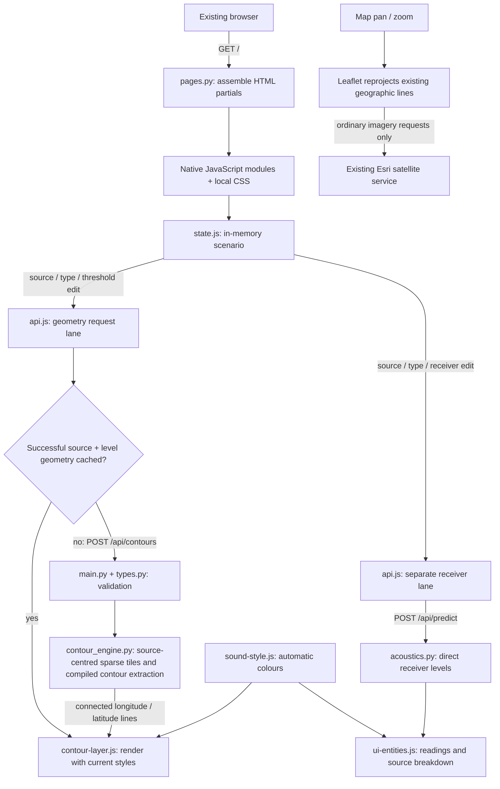
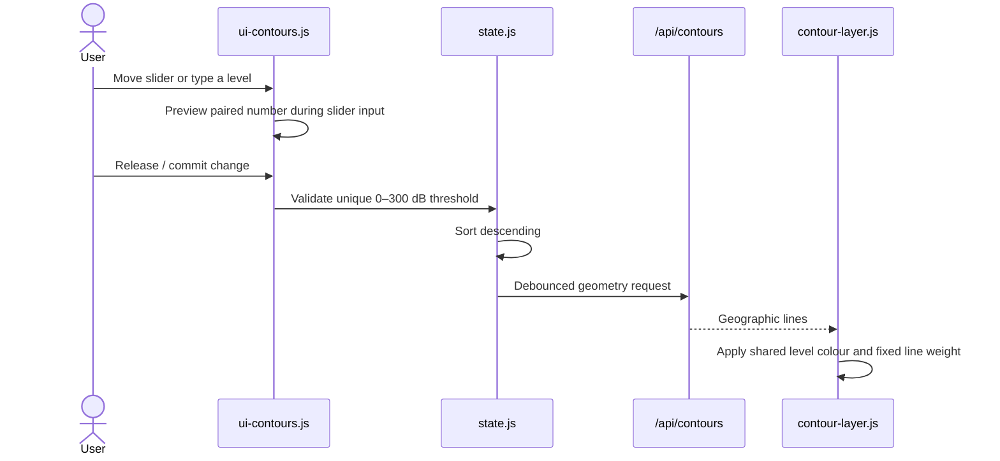

# Repository architecture and data flow

This is the architecture document requested as `ARCHITECURE.md`. The application remains
Python 3.13+, uv, FastAPI, Pydantic and Uvicorn, with plain HTML/CSS/JavaScript and bundled
Leaflet. NumPy and ContourPy were subsequently approved for compiled numerical/contour
operations; the frontend still needs no bundler or additional UI library.

## Structure

```text
Sound-Model/
├── pyproject.toml                 dependency groups, lint and strict type configuration
├── uv.lock                        reproducible dependency versions (unchanged)
├── src/
│   ├── main.py                    HTTP routes, validation errors, static serving
│   ├── types.py                   typed request/domain/response models
│   ├── acoustics.py               existing great-circle distance and energetic addition
│   ├── contours.py                scalar reference field, domain and contour entry point
│   ├── contour_engine.py          batched NumPy evaluation, sparse tiles, ContourPy and stitching
│   ├── assets.py                  deterministic JS/CSS media types across platforms
│   ├── pages.py                   HTML shell + partial assembly (standard library)
│   ├── templates/
│   │   ├── index.html             page layout, assets and model explanation
│   │   └── partials/              header, catalogue, sources, contours, receivers, map
│   └── static/
│       ├── js/
│       │   ├── bootstrap.js       ordered Leaflet/module loading and visible startup errors
│       │   ├── main.js            event orchestration, receiver/geometry request lanes
│       │   ├── sidebar.js         keyboard-accessible Scenario/Contours tabs
│       │   ├── state.js           scenario mutations and explicit change reasons
│       │   ├── api.js             JSON requests, cancellation and geometry cache
│       │   ├── map-manager.js     existing imagery provider, entity markers, placement
│       │   ├── contour-layer.js   read-only geographic lines and static labels
│       │   ├── ui-catalogue.js    machine type forms and cloud metadata
│       │   ├── ui-entities.js     source/receiver cards and coordinate forms
│       │   ├── ui-contours.js     descending paired slider/number rows and legend
│       │   ├── sound-style.js     shared automatic level colours
│       │   ├── sound-guide.js     illustrative, collapsible local-flavour reference key
│       │   ├── machine-presets.js eight provisional equipment guesses with origin notes
│       │   ├── types.js           shared JSDoc domain definitions
│       │   └── utils.js           DOM lookup, escaping, IDs and formatting
│       ├── css/                   tokens, base, layout, sidebar, map, contours, responsive
│       └── vendor/leaflet/        existing library, licence and provenance
├── tests/
│   ├── test_model.py              unchanged acoustic expectations and validation
│   ├── test_contours.py           analytical radii, topology and contour API checks
│   └── test_http.py               HTML/assets, prediction and sanitised validation errors
└── docs/contour-task.md            task scope, decisions and verification record
```

## Request and rendering flow



Source changes update lines and receiver values. Receiver changes only update readings.
Colours are derived automatically from absolute sound-pressure level, with one fixed 2.5 px
solid line weight. Only the global display toggle controls visibility. There are no manual
colour/width/style settings or contour drag handlers.
Cloud cover remains recorded metadata without an invented correction. No camera bounds are
sent to either endpoint, and no camera handler starts predictions. New satellite tiles may
still load when browsing another area: that is separate from acoustic computation.

Each request lane snapshots its payload, debounces edits, aborts previous fetches and rejects
out-of-date responses by version. Returning to cached geometry also invalidates an in-flight
request, preventing the A→B→A race found in the reference attempt. Source/threshold updates
hide old contours until current results are available. Failures clear stale geometry, report
the server message and offer Retry. Receiver failures do not destroy valid contours.
The geometry cache is session-local and limited to 12 results; reload discards the scenario.

## Combined noise and contour calculation

The physics remain the `walk-back` independent point-source model:

```text
Lp_i = LwA_i − 20 log10(max(1 m, distance_i)) − 10 log10(4π)
Lp_total = 10 log10(Σ 10^(Lp_i / 10))
```

A contour is a line where **the combined level** equals the selected threshold. Nearby sources
therefore produce merged outer contours and separate inner lobes; they are not separate circles
drawn without regard to other machines. This is energetic combination, not coherent phase
cancellation. The directional lobes in the example image also depend on physical conditions
not modelled here; this change does not introduce wind, barriers or source directivity.

For each threshold:

1. Compute a conservative domain from all source powers and positions, without consulting the
   viewport. Unwrap longitudes around the first source to keep a dateline-neighbouring pair local.
2. Use a quadtree to reject cells definitely wholly above or below the threshold. The spherical
   triangle inequality bounds distances from a cell centre; Mercator half-diagonals safely
   overestimate surface separation. This also discovers small rings that a coarse grid misses.
3. Refine potential crossings to a common depth based on the smallest relevant single-source
   radius. NumPy evaluates the cell bounds in batches of at most 2,048 points against all sources.
4. Stop at sparse 8×8-cell tiles. ContourPy generates connected paths inside each tile.
   Join open tile endpoints by exact lattice-edge/vertex identity; keep already closed rings.
5. Refine all contour edge crossings with vectorised bisection to the 0.02 dB vertex target,
   then convert to longitude/latitude. A 1e-10 dB extraction/bound-comparison offset includes flat attainable maxima.
6. Return connected polylines. Leaflet reprojects them on navigation without more geometry requests.

The vertex tolerance is numerical, **not an environmental prediction accuracy claim**. Straight
segments between vertices approximate the continuous field. Cells target at most 1/20 of the
smallest relevant source radius (minimum target 0.05 m). Fields that exceed the safe 640,000-cell
budget **per threshold** return an explicit 422 error instead of truncating results. Levels whose
combined-power propagation radius exceeds 200 km, or whose domain reaches ±85° latitude, also
return an explanation. Increase the threshold or narrow the scenario to reduce complexity.
A level above the possible maximum, no sources, or no levels produces empty geometry, not an error.
Up to 100 sources, 50 machine types, 20 receivers and 25 unique levels are supported by validation;
complex combinations can hit numerical safety limits before those counts.

## Simple editing and receiver feedback



The map's contour paths and labels are noninteractive: gestures pan the map, not edit a
threshold. Source/receiver location markers remain draggable. Receivers show a numeric
pressure level in a colour from the same absolute palette as contours and the guide. Pending,
failed and empty results use neutral states instead of stale numbers or a misleading 0 dB.
Updating a reading does not replace source markers or move the camera.

Machine data starts with eight explicitly guessed equipment categories in machine-presets.js.
The local `/machine-estimates` page records the origin, limits and unavailable public references;
it does not claim manufacturer/site evidence. Users can replace both a value and its note.
The compact equipment editor is closed initially so selecting/placing a machine stays prominent.

Greenbushes navigation uses `fitBounds` with a wider approximate mine-area overview and padding
for overlays, rather than a fixed point/zoom. The rectangle is a navigation aid, not a surveyed
lease or pit boundary. The top-right sound guide is collapsible and labels its comparisons as
illustrative pressure levels, separate from the machine sound-power inputs.

## HTTP boundaries

| Endpoint | Request | Response / responsibility |
| --- | --- | --- |
| GET `/` or `/index.html` | none | Assembled HTML; partials aren't fetched asynchronously |
| GET `/machine-estimates` | none | Explicit origin and limits of guessed catalogue values |
| GET `/js/*`, `/css/*`, `/vendor/*` | static path | Local frontend assets only |
| GET `/api/health` | none | Server readiness and model ID |
| POST `/api/predict` | `Scenario` | Receiver results keyed by ID, provenance and cloud metadata |
| POST `/api/contours` | `ContourRequest` (`Scenario` plus `levels`) | Connected geographic lines per threshold, tolerance and model ID |

The previous `bounds`/heatmap `grid` API is removed; both endpoints reject unknown fields.
Styles never enter acoustic input. Pydantic rejects duplicate IDs, broken source references,
non-finite numbers and invalid ranges. Validation errors omit raw input/context so NaN/Infinity
never cause error-response serialisation failures. Only `src/static` is mounted for assets;
Python source, templates, lockfiles and repository metadata are not served as static files.

## Development and limits

```sh
uv sync --frozen
uv run uvicorn src.main:app --host 127.0.0.1 --port 8767
uv run pytest
uv run ruff check .
uv run ruff format --check src tests
uv run pyright
```

Keep Python annotations and Google-style `Args`, `Returns` and `Raises` docstrings on changed
public helpers; browser modules use JSDoc parameter/return annotations and shared domain typedefs.
No JavaScript bundler or new UI framework is required. NumPy and ContourPy are approved
Python runtime dependencies, pinned through uv.lock. The scalar evaluator remains a test reference.

The reference ZIP informed the module split, but the coherent-wave mode was excluded as the
owner requested. The adaptive contour algorithm replaces its coarse source-domain grid and
rounded-coordinate stitching. The subsequent NumPy/ContourPy optimisation retains the
source-based adaptive domain, fixed accuracy target and exact tile-edge stitching. Style changes and receiver requests have separate invalidation.

Model limitations remain: no ground reflection, terrain, diffraction, atmospheric absorption,
refraction or validated cloud effect. This prototype does not establish machinery inaudibility
or compliance. Existing provider attribution and satellite URLs are preserved; no new provider
has been selected. Browser regression checks block external imagery, testing geometry and
interaction independently of remote service/network availability.

## Physics and browser startup audit

See [the audit](docs/physics-audit.md) for equations, physical limits, contour regression
checks and the reported VS Code blank-map investigation. Bootstrap failures are visible;
script/style media types do not depend on Windows registry settings.

## Due-diligence work order

See [tasks](docs/tasks/README.md) for assessment criteria, evidence acquisition, propagation
engine selection, validation/uncertainty, audit reports, mitigation and operations. Current
optimisation notes and evaluated library candidates are in [library options](docs/library-options.md).
The allowed input range is 0–300 dB(A) for source powers and contour thresholds; longitude
remains limited to ±180°. Numeric range is separate from equipment plausibility or model validity.

## Desktop workspaces

The sidebar defaults to Scenario (machine placement and compact receiver results). Contours
is a second tab. Switching tabs hides panels without destroying form state and has no acoustic
side effects. Equipment data, coordinate forms, source breakdowns and model/cloud settings
are disclosed on demand. Tabs support standard arrow/Home/End keyboard navigation.
