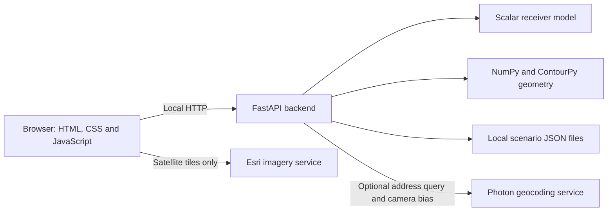
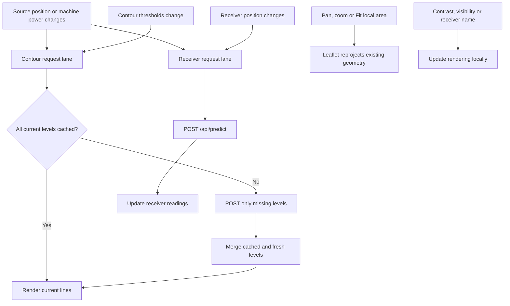
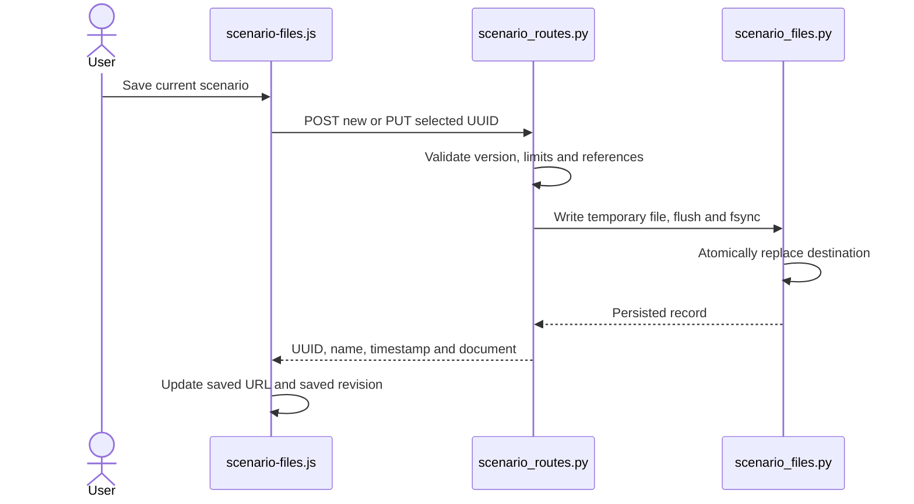
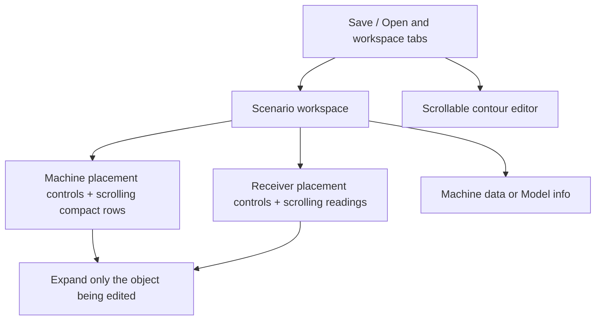
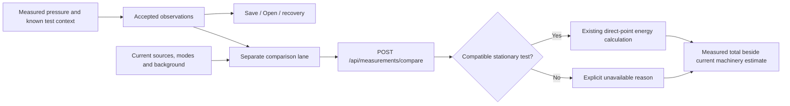
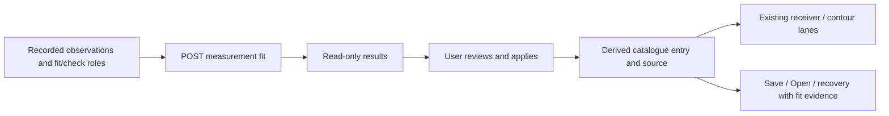

# Repository architecture and data flow

This is the current technical guide. The filename `ARCHITECURE.md` is retained for existing
links. Start at the [documentation index](docs/README.md) for user-facing explanations.

## System at a glance

The app uses Python 3.13+, uv, FastAPI, Pydantic and Uvicorn. The frontend uses plain modules
and bundled Leaflet; it has no build step. NumPy and ContourPy speed up evaluation/extraction;
they do not add missing propagation physics. Imagery uses the external tile service; optional address lookup also contacts Photon.

## Where to look

| Area | Files | Responsibility |
| --- | --- | --- |
| HTTP and pages | `src/main.py`, `pages.py`, `assets.py` | Routes, server-assembled partials, deterministic asset MIME types |
| Validated inputs | `src/types.py` | Catalogue, source/receiver references, finite values and limits |
| Receiver calculation | `src/acoustics.py`, `scope.py` | Scalar spreading/energy sum, then background relevance |
| Contour calculation | `src/contours.py`, `contour_engine.py` | Domain, sparse tiles, line extraction, stitching and per-level outcomes |
| Persistence | `src/scenario_files.py`, `scenario_routes.py` | Versioned schema, safe UUID filenames, atomic saves and listing |
| Frontend entry/state | `src/static/js/bootstrap.js`, `main.js`, `state.js` | Ordered startup, observable state and request orchestration |
| Requests/cache | `src/static/js/api.js` | Debounce, abort/version protection and geometry cache |
| Map/lines | `src/static/js/map-manager.js`, `contour-layer.js`, `local-area.js` | Imagery, markers, tooltip layout, geographic lines and halos |
| Forms/files | `src/static/js/ui-*.js`, `scenario-files.js`, `sidebar.js` | Catalogue, entities, thresholds, tabs and Save/Open |
| Shared appearance | `sound-style.js`, `sound-reference.js`, `sound-guide.js`, `illustrations.js` | Automatic colours, guide/default levels and original icons |
| HTML/styles | `src/templates/`, `src/static/css/` | Assembled partials and styles split by responsibility |
| Third-party assets | `src/static/vendor/leaflet/` | Bundled Leaflet 1.9.4 with provenance/licence |
| Verification | `tests/`, `scripts/benchmark_contours.py` | Numerical/API/persistence tests and repeatable benchmark |
| Agent guidance | `AGENTS.md`, `.agents/`, `scripts/check_agent_skills.py` | Project rules and pinned skill integrity |

## Which changes calculate sound?

`main.js` currently also refreshes the lanes for catalogue mutations and restores. Cloud
cover is metadata and adds no acoustic correction. Camera movement can load tiles and mark
a saved camera view dirty, but never starts acoustic requests. Changing a receiver leaves
contour geometry alone. Receiver names use a separate `receiver-name` notification: headings,
map badges, tooltips and accessible descriptions update in place, with no acoustic request or marker replacement.
Open receiver details and active name selection survive a pending reading response. Stale results are hidden during relevant pending requests; valid cached levels remain visible
while missing ones load.

Each request lane debounces for 150 ms, aborts superseded browser fetches and uses a version
counter to reject stale responses, including the A→B→A cache race. Aborting a fetch does
**not** promise cancellation of work already running on the Python server.

The geometry cache holds at most **32 level entries**, evicting the least recently used.
Each key includes the expected API model (`full-space-point-source-v1`), 0.02 dB numerical
tolerance, threshold and every active source's position/power in original order. Multiplicity
and order matter: sources contribute independently, and the first longitude anchors the
numerical projection. Camera, visual style, receivers, unused catalogue entries, names and
cloud metadata do not change contour geometry. Future model/accuracy contract changes must
update the frontend cache contract as well as the backend; the cache is session-local and
clears on reload, not persisted in saved scenarios.

`main.js` snapshots cached levels for the current source signature, requests only missing
thresholds, then merges responses in current threshold order. Both `ok` and `empty` results
are reusable, even when another level fails. Failures and missing server results are not
cached, so Retry requests those levels again. HTTP failure marks only missing levels failed
and keeps unaffected cached lines. A response with a different model/tolerance clears the
cache and hides the incompatible geometry, with an explicit reload message.

Cached values are detached on store/read to prevent renderer mutations. Every edit goes
through the existing request lane, including all-cache hits: its abort/version guard rejects
late threshold/source responses before rendering **or** caching them. Pending renders contain
only current-signature cached levels; removed or old-source lines disappear immediately.
`equipment-metadata` edits update catalogue forms and map details locally, without either
acoustic lane. `toPayload()` strips notes, source references and operating modes; full save
snapshots retain them. The plain-text editor validates 500/200 Unicode codepoint limits and
escapes content. Version-1 legacy files default missing fields to empty strings.

No equation, extraction tolerance, sampling budget, scope policy or source contribution is
changed by this reuse.

## Calculation pipeline

The [model guide](docs/model.md) explains the equations and missing physics. Both scalar and
batched paths evaluate independent omnidirectional sources using great-circle horizontal
distances. Source distances below 1 m use a numerical limit. Energies combine logarithmically;
no coherent phase cancellation or numerical weather correction is applied.

Before geometry extraction, thresholds below the background boundary return `negligible`
without tracing. For each remaining requested contour level:

1. Build a conservative source-centred domain, unwrapping longitude around the first source
   so date-line neighbours stay local. The viewport is not an input.
2. Prune cells wholly above/below the threshold using conservative distance bounds.
3. Evaluate with NumPy in batches of up to 2,048 points against all sources. Refine crossing
   regions to a common depth, targeting 1/20 of the smallest relevant source radius with
   a minimum 0.05 m projected cell target.
4. Extract lines from sparse 8×8 tiles with ContourPy. Join endpoints using exact lattice
   identities, then refine crossings by vectorised bisection.
5. Convert to longitude/latitude without clipping or a nearest-source distance filter.
6. Return that level's `ok`, `empty` or `failed` result and continue with the other levels.

The 0.02 dB tolerance is a target at line vertices, not environmental uncertainty.
Straight segments still approximate the field. Numerical guards retain 640,000 charged cells
per level and complete domains inside ±85° latitude. The 200 km radius cap is removed;
projection support is checked in log-radius space before exponentiation to avoid overflow
for extreme finite thresholds. Do not omit machines or silently crop lines to force a result.

## Background and display

`scope.py` derives `boundary_level = background_db + 10 log10(expm1(0.1 ln(10) / 10))`.
This is approximately background minus 16.327747 dB, the machinery contribution at a 0.1 dB
increase in the combined total. It is a display rule, not new attenuation or an audibility test.
`screen_receiver` compares the **all-source total** to that threshold; below it, status is
`negligible` with no numeric level or contribution breakdown. There is no receiver-distance
cutoff. Empty scenes retain `no_sources`, and near-field flags survive the relevance filter.

`background_db` is nullable, finite pressure metadata saved in version-1 documents and
included in acoustic payloads. Omitted legacy fields default to null: no background is guessed.
The browser mirrors the threshold in `background.js`, adds one derived line to the level union,
and flags its dotted label. A 1e-9 dB comparison allowance at contour classification absorbs
cross-runtime floating-point differences; receiver comparison uses the unrounded threshold.
The auto line is not saved as an ordinary contour. Background notifications refresh receivers,
geometry and slider range; camera, style and name-only changes still make no acoustic requests.
Both geometry and range cache keys include background, so classified results cannot leak
between backgrounds. `negligible` contour results can be cached with that complete signature.

The optional `acceptable_level_db` defaults to null in version-1 saves and browser state.
It is excluded from direct receiver requests: only its numeric threshold joins the deduplicated
contour-level union. Saved/browser editable levels enforce 25 unique levels including this value; the API
allows 26 to accommodate the derived background boundary.
`lineSettings()` emits one setting per unique level and flags a shared ordinary/reference level
as special. Changing/clearing the reference uses the contour lane, including cache-only style
changes for matching levels; it never updates source powers or receiver pressures.

The reference is a heavier dashed line in the automatic level colour, with a distinct label
“Acceptable level — user-set”. Its label remains visible even for a small ring. High contrast
adds a matching dashed halo. The slider stays disabled only until a useful source-based interval is available; it can
set an initially unset criterion by dragging. Range updates do not change the numeric criterion. Per-level error reporting identifies the reference and preserves other
lines. Ordinary-row removal tolerates the notification-before-DOM-update phase. Save snapshots
and draft recovery retain the optional value; neither classification nor legal/audibility
assessment is introduced.

Default contours and the guide share `sound-reference.js`: 30/40/60/80/100 dB(A). Thresholds
sort descending; colour and a solid 2.5 px line weight are automatic. A separate lower pane
provides optional white halos. Contour labels sit below object badges. Contours cannot be dragged.

Machine icons show category and number; hover/focus exposes name and LwA, while selection
opens the evidence note. Tooltip width is intrinsic with a 260 px cap. Measured placement
chooses above/below and shifts sideways to minimise overlap with controls while respecting map
edges. Open tooltips are refitted after a map resize; their gap accounts for marker height.
Panning dismisses transient cards. Receiver badges show persistent identity alongside
pressure/units or status text, on an opaque background. They size to content (104–220 px
wide), clamp names to two lines and retain the full name in hover/focus and accessible text.
Named badges keep a compact R-number for duplicate names; unnamed ones show Receiver N.
Measured dimensions centre each badge on its coordinate and update Leaflet icon metadata
for keyboard-focus panning. Name and reading updates change existing text/style nodes,
without replacing the marker or badge, preserving focus and active dragging. Both marker
types remain anchored at their coordinates.

### Local-area navigation

`local-area.js` computes a camera group independently of acoustic state. Each Fit action
chooses the object geographically nearest the current map centre, with stable ID/collection
ties (a source and a receiver may share an ID). It reads the centre afresh on every click;
selection, focus, placement and edit history do not determine the group. There is no saved
or transient anchor state to restore.

Candidates sort by anchor distance, then ID and collection using JavaScript string ordering.
The greedy group accepts a candidate only when it is within 10,000 m of every existing member
(mean Earth radius 6,371,008.8 m; 1 µm floating-point boundary allowance). It is deterministic,
not a maximum-clique search. This camera rule does not filter acoustic sources or change the
separate receiver display policy. It never fits automatically on edits or arriving predictions.

The button is disabled without objects. `fitBounds` caps zoom at 16 and reserves a rectangle
clear of currently visible overlays: candidate horizontal spans are tested against merged
vertical obstacle intervals and the largest free rectangle is used, with a central fallback
when the controls cover the map. Fit closes a selected popup, changes the camera and marks
that view dirty for Save/recovery; it sends no acoustic request. Grouping is derived for the camera only, not stored as additional saved inputs.

The eight preset types are project-authored guesses. `/machine-estimates` documents their origin.
Fresh scenes and the Greenbushes button use `DEFAULT_VIEW` (−33.8675, 116.07647, zoom 14).
Saved camera views take precedence. The main grid fills the viewport with no branding header. The humorous
guide compares pressure levels and does not supply emissions or approved assessment thresholds.

## Placement history

`ScenarioStore` keeps at most 50 completed add/move/remove commands for sources and receivers.
A command records collection, before/after entity, list index and action label. Move replay
changes only coordinates, retaining later receiver labels and current catalogue power. Removal
captures the current entity so a later redo/undo also retains metadata edited after placement.
Restored entities keep their IDs and original list positions. No-op moves consume no entry.

Replay transfers commands between undo/redo stacks without recording a new action. New
placement edits clear redo. Source commands notify `geometry`; receiver commands notify only
`receivers`, reusing existing cache/request version guards. Save/recovery revision tracking
therefore sees ordinary accepted edits; no named file is written automatically. History is
excluded from both the API payload and recovery/save snapshots. Open/New/recovery and demo
replacement clear it. Deleting an unused catalogue type clears both stacks; deletion of an
in-use type is guarded in the store as well as the UI.

Persistent map buttons expose the next action through their titles. Keyboard handlers ignore
inputs, selects, textareas, editable content, IME composition and open dialogs. Camera, contour,
name and catalogue power edits are outside placement history and keep their existing behaviour.

Ctrl-click source placement passes through the same `addSource` history/calculation path.
After an accepted click, `MapManager` resumes source mode with a UI-only notification if
Control was held and fewer than 100 sources exist. The final ordinary click, cancellation,
undo/redo and the 100th source leave placement inactive. Modifier state is read from the
click event, so releasing Control or changing windows cannot leave a latched repeat flag.
Receiver placement remains single-use.

## Save/Open contract

Receivers accept optional `name` metadata (up to 80 characters, empty by default). Duplicate
labels are allowed; receiver IDs still identify results. Existing version-1 files without names
load without being rewritten. Explicitly saving normalises the default field. Naming has no
effect on receiver calculations or contour geometry. The optional editor lives in receiver details;
sidebar headings, persistent map badges and hover/focus descriptions use the name.
Accepted edits update locally as the user types; whitespace is trimmed when leaving the field.
Overlong text is rejected explicitly, retaining the previous accepted label.

Version-1 documents include catalogue notes/kinds, sources, receivers, levels, cloud metadata,
view, contrast and visibility. They do not contain imagery or calculated results. Names are
labels; server-generated UUIDs determine filenames. Data lives under ignored
`local-data/scenarios/` unless `SOUND_MODEL_DATA_DIR` overrides it.

Atomic replacement preserves an existing save on a failed write. Unreadable files are counted
without blocking readable saves. Browser revision tracking leaves edits dirty if made during
an in-flight save. Saved URLs restore the last saved version. A separate version-1 localStorage
recovery envelope contains inputs, saved identity, timestamp and a per-tab writer token.
`draft-recovery.js` observes the Save/Open lifecycle, debounces accepted edits for 200 ms,
and flushes on page exit. Restore/Discard is explicit. Restore validates through the non-writing
`POST /api/scenarios/validate` route, checks saved identity, then marks the working scene dirty.
A missing save becomes new unsaved work. Named files are never written by recovery.

Storage events and ownership checks pause competing tabs. A restore captures the exact reviewed
envelope and rejects a changed candidate after async validation. This is a single best-effort
browser draft, not a transactional multi-user system, backup or recovery history. Clearing
browser data, unavailable storage or edits before the debounce/browser disk flush can prevent recovery. Portable
import/export, cloud sync, audit history and named-save conflict protection are not implemented.

## HTTP API

| Method and path | Result |
| --- | --- |
| GET `/`, `/index.html` | Assembled HTML shell and partials |
| GET `/about`, `/machine-estimates` | Current model explanation and preset notes |
| GET `/js/*`, `/css/*`, `/vendor/*` | Files under `src/static/` only |
| GET `/api/health` | Readiness and model ID |
| POST `/api/predict` | Validated `Scenario` → receiver results keyed by ID |
| POST `/api/contours` | `Scenario` plus `levels` → independent per-level results |
| GET `/api/scenarios` | Saved metadata and unreadable-file count |
| POST `/api/scenarios/validate` | Validate a `ScenarioDocument` without file reads/writes |
| POST `/api/scenarios` | Name/document → new record; HTTP 201 |
| GET `/api/scenarios/{UUID}` | Saved record; HTTP 404 if missing |
| PUT `/api/scenarios/{UUID}` | Validated replacement of an existing record |

Invalid input uses HTTP 422 with sanitised error details; raw input/context is omitted.
A valid contour request returns HTTP 200 even if individual levels fail. File failures use
HTTP 500 with a user-readable message. Unknown fields, duplicate IDs, broken type references
and non-finite values are rejected. Limits are 50 types, 100 sources, 20 receivers and
25 editable unique levels (26 with the automatic boundary in API requests). Machine powers
allow 0–300 dB(A); contour/reference thresholds accept any finite value. The source-power
ceiling is not a realistic machinery specification. Coordinates use latitude ±85° and longitude ±180°.

Interactive Swagger/ReDoc and OpenAPI routes are disabled. There is no authentication for
this local API. Only `src/static` is mounted; source, templates and private scenario files
are not public static assets. See the [developer guide](docs/development.md) for commands,
verification and startup troubleshooting. Historical audits are indexed in [docs](docs/README.md).

## Practical slider range

`POST /api/contour-range` takes source inputs only. `contour_range.py` uses total sound-power
spreading at a projection-derived distance and the background boundary for a lower candidate; the
combined field evaluated at source centres for a conservative peak candidate. It rounds
inward to 0.1 dB with a 0.05 dB margin and verifies endpoints through unchanged `build_contours`.
A failed low endpoint is narrowed toward the verified upper endpoint with at most 12 bisections.
No interval is invented when unavailable. This is a useful checked interval, not the maximal
feasible range or a guarantee that every intermediate extraction avoids numerical guards.
Numeric entry accepts any finite level, retaining per-level errors and the background relevance policy.

The browser uses a separately versioned request lane and an eight-signature session cache.
Only source-signature changes request a range; panning, threshold edits and metadata changes
do not. Pending/failed ranges disable the slider with a reason, and transient HTTP failures
expose Retry. Ordinary, acceptable and draft sliders share this interval. Source changes
preserve entered numbers even outside new slider bounds. Endpoint probes do not alter equations, saved inputs, geometry tolerances or budgets.

## Contour label priority and explicit entry

The acceptable label has an opaque background in pane `acceptable-labels` (675), above
ordinary contour labels (450), markers (600) and transient tooltips (650), while opened
popups and controls keep their higher interaction layers. Label priority is independent of
threshold ordering, high contrast, zoom and hide/show; labels stay pointer-transparent.

Add contour opens a draft of the existing slider-and-number row, focusing its numeric field.
Draft dragging previews a number without changing state. Enter commits once; Escape or ×
cancels without notifying state. `addContour(requestedLevel)` validates the
exact submitted value and combined level budget, rejecting rather than replacing it. The
no-argument helper retains its previous programmatic fallback; the UI always passes a number.

## Desktop scenario workspace

`sidebar-simple.css` gives the desktop sidebar a responsive 380–480 px width, retaining
more than half the map at the supported desktop sizes. The header stays outside the
scrolling lists. The Scenario panel divides remaining height between machine and receiver
sections; each list scrolls independently beneath its placement controls. Contours has its
own scroll area. At 650 px and below the layout returns to normal document flow.

`EntitiesUI` uses native details/summary rows: machine type and LwA, or receiver name and
LpA/status, remain visible while editors and removal controls are collapsed. Near-source
and distant-source flags remain in the summary; expanded rows retain the full explanation.
Receiver contributions have a separate disclosure so they do not separate names from
coordinates. State and calculation lanes are unchanged.

`sidebar.js` hides existing workspace panels rather than replacing them. Machine data and
Model info remain mutually exclusive; opening one closes the other without removing
form nodes or committing drafts. Disclosure, tab selection and list scrolling do not notify
the acoustic store or request predictions.

On desktop, opening a visible root editor applies `expanded-editor` to the sidebar. The
same form nodes remain in place, but capped list/catalogue/settings scroll boxes become
ordinary content under one viewport-height sidebar scroller. Explicit summary clicks reveal
whole cards when they fit; nested frequency editors also include their save action. Longer
forms align at the top. This reveal is driven by user activation, not prediction refreshes.
A sticky Close editor action closes root disclosures and restores compact list offsets.
Offsets are captured before native disclosure expansion can change browser scroll anchoring.
Toggle/DOM observation keeps the mode correct after renderer updates; hidden workspaces do
not force expanded mode. Narrow screens retain document flow. No acoustic notifications,
form clones or new dependencies are involved.

## Address search adapter

`POST /api/geocode` accepts bounded search text and a map-centre bias, without acoustic
inputs. `geocoding_routes.py` maps busy/unavailable outcomes to HTTP 429/503. `geocoding.py`
validates Photon GeoJSON, converts longitude/latitude order, and returns up to five labelled
points with optional south/west/north/east bounds. Invalid points are discarded; unsuitable
extents fall back to the valid point. No coordinate is clamped or fabricated.

The standard-library HTTP client uses the fixed approved Photon HTTPS host, a five-second
timeout and a 256 KiB response limit. Per-process controls allow one live call at a time,
one start per second, a five-minute/128-entry memory cache and bounded provider cooldowns.
Busy calls do not queue; no automatic network retry occurs. Search bodies are not placed in
local access-log URLs or saved scenarios. Camera bias and search text still reach Photon;
private machinery/receiver inputs do not. No Java, database or new package is installed.

`address-search.js` is an editable combobox bound to the local address endpoint, with a
500 ms typing pause, request spacing, aborts and version checks. It renders text-only
suggestions and ignores late responses even when cancellation is not honoured. Keyboard
focus stays in the input; aria-activedescendant identifies the highlighted option. Only
explicit mouse/keyboard selection invokes the navigation callback in `main.js`, which
fits returned bounds or centres a point. No acoustic store mutation is made. Existing
camera dirty/recovery tracking applies; search history and result lists are not saved.

The compact map navigation panel retains the coordinate form. Opening coordinates closes
search suggestions after the click, avoiding layout shifts during pointer activation.
Search attribution stays with results/selected labels, and About explains external query
data. Search, no-match, offline and 429/503 states remain separate from acoustic failures.

## Map object removal

`MapObjectControls` owns popup actions and a separate temporary marker layer. Bindings use
collection-qualified IDs, so reordering/renaming never changes the deletion target.
`MapManager` clears/rebinds these alongside ordinary marker rebuilds, and refreshes labels
and offsets after receiver/name updates. Delete offsets use the current badge width and
height. Reading updates preserve the original marker node and the separate delete controls.
Dragging updates overlay positions; camera changes only
refresh visibility/layout, with no state or acoustic notification.

The control pane is 680; object popups use 720 inside the Leaflet map pane. Since outside
navigation/guide overlays have their own stacking context, popup padding also uses the
existing `freeMapRectangle` helper to keep the full popup in unobstructed map space.
Ctrl controls flip inward at map edges.

Control key events toggle the temporary layer; repeat keydowns cannot resurrect it after
Escape. Blur, visibility changes and editor/dialog focus clear it. Mouse/pointer propagation
is stopped before a destructive action; Enter/Space activation is explicit because native
button activation with Ctrl varies. Repeated shortcut clicks within 300 ms at the same pointer location, or click-detail
>1, are ignored to prevent double-click deletion of an underlying object.

Both paths check current identity before calling `removeSource`/`removeReceiver`. These
existing store commands handle history, dirty state, recovery and calculation lanes. A
stale control is a no-op. Marker selection cancels placement with a presentation notification
before opening a popup, so dismissing details cannot accidentally place another machine.

## Optional frequency-band foundation

`Spectrum` is nullable on machine types and the scenario's `background_spectrum`, with the
same optional fields in version-1 saves. It carries nine fixed unweighted octave levels,
unknowns as null, positive/unknown energy-average duration, fixed Z/Leq basis and user evidence.
No default spectrum or A-weighting coefficient is introduced. Existing overall equations and
geometry signatures ignore these fields.

`bands.py` evaluates receivers independently using the existing distance/spreading/energy
helpers. Each band requires every active source's level and compatible known duration. The
background comparison additionally requires matching background duration. Missing sources
are identified rather than omitted; unmatched basis yields no difference. No-source and
numeric-failure states are explicit. The 1 m near-field flag survives. `Prediction.band_results`
is a separate per-receiver collection; existing `receivers` and contour output are unchanged.

`band-ui.js` supplies shared source/background fields and a neutral comparison table. Source
fields live in the existing catalogue editor; background fields in Model info. `spectra`
notifications refresh only the receiver lane; a reference-only source edit remains metadata.
Background updates do not rebuild source editors or lose unrelated drafts. Open receiver band
details survive pending results. Save/recovery snapshots retain full evidence; old scenes
restore null profiles. All acoustic data remains local to the backend; Photon receives no bands.
See the [contract](docs/frequency-band-contract.md) for units, statuses and validation.

## Site observations

`measurements.py` validates pressure observations and captured model setup. The scenario-file
schema defaults old files to `measurements: []`. `ui-measurements.js` owns a distinct violet
marker layer and compact editor, using a separate `RequestLane` and a bounded per-point cache.
Observations are absent from ordinary receiver/contour payloads. Saved snapshots and recovery
retain them, while machine history never moves or deletes historical readings. Measurement
pins participate in camera fitting only; they are not acoustic sources.

The comparison uses all active sources. A changed/missing linked setup blocks numerical
comparison without discarding the observation. Reading/name/note/meter edits reuse cached
results; context/location changes request affected missing results. Late responses cannot
replace a newer scene or rebuild active editor fields. Neither measured pressure nor comparison
results feed source power, contours or calibration. See the
[measurement contract](docs/measurement-contract.md) for exact fields and eligibility.

## Explicit measurement fitting

`measurement_fitting.py` is a separate read-only preview endpoint. It background-corrects
eligible selected LAeq readings and fits one fixed source by least squares in pressure dB;
held-back check rows never affect power. Machine mode requires confirmed isolation and
matching recorded context. Area mode uses a user-marked equivalent centre/circular footprint
and outside observations, with no individual source required.

`ui-fitting.js` owns roles, map-centre selection, footprint rendering and preview invalidation;
`fit-preview.js` renders escaped read-only results both in previews and saved catalogue evidence.
Form/scene edits abort and version-invalidate pending responses. Only explicit Apply calls
`ScenarioStore.applyMeasurementFit`, atomically creating a derived catalogue entry for one
instance or replacing active sources with one labeled area source after confirmation.
Accepted observations, background and receiver/contour settings remain unchanged. Existing
prediction/cache lanes then consume ordinary source coordinates and effective LwA. No fitted
metadata is sent to those lanes. Save/Open/recovery retain the detached fitting evidence;
manual later edits do not rewrite its historical inputs/results.

## First-use workflow

`workflow.js` arranges existing controls into Machines, Measurements and Contours workspaces,
with listening points shared by the two modeling paths. It does not own acoustic data. Existing
DOM nodes are moved rather than recreated, retaining delegated handlers and unsaved drafts.
The measurement journey reveals Setup, Readings or Result, opens invalid fields for correction,
reuses existing activity labels and shows selected-role/activity feedback. Custom events reveal
measurement editors from pins/results and hand successful application to the listening-point
action. `ui-fitting.js` still owns request invalidation and explicit application; all backend
eligibility and background rules remain authoritative. No missing metadata is inferred.
