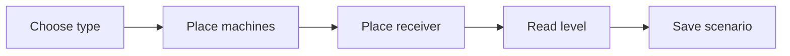

# Sound-Model

A proof of concept to explore how noise from several machines combines around a mine or another work site.
Place equipment and listening locations on a satellite map, compare calculated contour
lines, and save scenarios to revisit later. Greenbushes is the starting location; the app
also works at other coordinates.

**This is a screening tool. It cannot establish that a town will not hear machinery or
that an operation meets regulatory requirements.** The current model omits important
outdoor propagation effects and uses explicitly guessed starter equipment levels.

## Start the app

You need **Python 3.13 or newer and uv**. From the project folder:

```sh
uv sync --frozen
uv run uvicorn src.main:app --host 127.0.0.1 --port 8767 --reload
```

Open <http://127.0.0.1:8767> in Edge, Chrome or Firefox. No Node.js or frontend build is
required. `--reload` restarts the backend after code edits; navigating the map does not
recalculate sound. Satellite imagery needs access to `server.arcgisonline.com`; optional
address search uses `photon.komoot.io`.

## Build your first scenario



1. Select a type under **Machines**, choose **Place machine**, then click the map.
2. Choose **Place a receiver**, then click a listening location. Its coloured number is
   the calculated machine contribution there, excluding background noise.
   Expand its receiver row to give it an optional name, such as Town boundary.
3. Hover or focus a numbered equipment icon to see its type and sound power. Click/Enter
   opens its evidence note. Drag machine or receiver markers to move them.
4. Open **Contours** to add/remove levels or edit them with a slider or number. Levels
   sort automatically. **Add contour** focuses a number field; Enter adds that exact level. **High contrast** adds white outlines for busy backgrounds.
5. Choose **Save**, name the scenario, and save again after edits. **Open** lists saved work.

**Undo / Redo** beneath the map zoom controls reverses machine and receiver placement, moves and removals.
Keyboard shortcuts work outside text fields; history lasts for the current working scene.
Delete directly on the map by clicking an object, then **Delete**. Hold **Ctrl** to reveal
small red **×** controls for one-click removal; Undo restores the object.

**Greenbushes mine** returns to the starting mine view. Fresh scenarios open at
−33.8675, 116.07647 with zoom 14; saved scenarios retain their saved view.
**Fit local area** frames nearby objects around the object nearest the current map centre,
keeping every pair within 10 km. It changes only the view. Type an **Address or place**, then choose a suggestion to move the map. Arrow keys and
Enter also select a result. **Go to coordinates** remains available. **Machine data** holds the equipment catalogue
and editable estimate notes. On desktop, Save and tabs stay at the top while machine and
receiver lists scroll separately. Expand an object row to edit it; Machine data and Model info
share the advanced-settings space.

## What the numbers mean

| Display | Meaning |
| --- | --- |
| Machine sound power, **LwA** | The equipment emission input, not a reading at a listening location |
| Receiver pressure, **LpA** | Combined calculated contribution from the machines at that receiver |
| Contour | Locations where the combined pressure level equals the selected threshold |
| Sound snapshots | Humorous approximate pressure comparisons; not equipment specifications or limits |
| Outside scope | Nearest machine is more than 10 km away; a numerical extrapolation is hidden |

Default contours match the guide: **30, 40, 60, 80 and 100 dB(A)**. A failed contour reports
its level/reason while successful levels remain visible. Colours describe levels, not compliance.
Under **Contours**, set an optional **Acceptable level** to draw a dashed reference labelled
“user-set”. It starts blank, shares matching thresholds, and is saved with the scenario.
Cloud cover is recorded only. Negative decibels are possible because zero dB is a reference,
not zero sound. Read [how the model works](docs/model.md) or open **About** in the app.

The eight starter types are project-authored guesses, not verified Charles Hull or Talison
fleet data. Replace values and notes with traceable equipment sound-power evidence. The
in-app **Estimate notes** page records their origin.

## Keep your work

Saves are local to the computer running the Python backend, under `local-data/scenarios/`.
Back up that folder. A saved `?scenario=...` URL restores its **last saved version** on reload;
a separate browser draft offers **Restore/Discard** for unsaved edits. Restoring never
updates a named save automatically. Recovery is not a backup and browser storage can be cleared. `SOUND_MODEL_DATA_DIR` can select another storage folder.
No scenario files are pushed to GitHub. See the [user guide](docs/user-guide.md) for details.

## Documentation and agent work

Use the [documentation index](docs/README.md) to find the user guide, model explanation,
architecture, developer checks and historical change records. The approved POC task queue and
parked wider themes are in the [backlog](docs/tasks/README.md). Work on one selected task;
creating this plan does not start implementation of the queue.

All 25 skills from [Agent Skills](https://github.com/addyosmani/agent-skills) are installed
under `.agents/skills/`. Start a new Codex session after pulling to discover them. Project
rules live in [AGENTS.md](AGENTS.md); the [integration guide](.agents/README.md) records
provenance and usage. No global plugin installation is required.

## Licence

Original project material is proprietary, with use reserved to **Jakespitteler** unless the
owner gives prior written permission. See [LICENSE](LICENSE). Third-party material retains
its own terms, described in [THIRD_PARTY_NOTICES.md](THIRD_PARTY_NOTICES.md).
