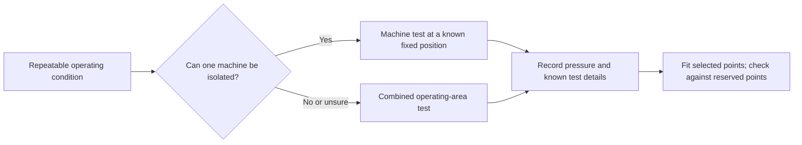

# Taking measurements for the POC

[App instructions](user-guide.md#record-site-measurements) · [How fitting works](measurement-fitting.md)

**Aim:** collect readings that help estimate machinery noise towards town, then check the
estimate against readings kept out of the fit. This is a practical POC plan; it does not
establish a maximum sustained town level or replace an acoustic assessment.

## Before going out

Find out whether the meter records **LAeq**: an A-weighted sound-energy average over a known
period. Record its make/model and settings when available. A live Fast/Slow display or LAmax
is not LAeq. If the reading type is unknown, record **Unknown** in the app; keep the observation
without using it to calibrate. Follow the meter instructions for microphone orientation,
windscreen and any before/after instrument checks. Do not invent missing instrument details.

Choose a repeatable operating condition, such as **Loaded digging** or **Steady idle**.
Test representative sustained work, rather than treating a brief start-up peak as sustained
noise. Keep different activities in separate groups; one label does not make different
conditions comparable.

Plan several accessible positions at different distances and directions, including towards
town where practical. Use approved site access; do not approach operating equipment just to
reach a preferred distance. Reserve some positions as **Check only before inspecting the fit**.
The app needs at least two Fit locations and one separate Check location; that is a software
minimum, not evidence that three points are sufficient.

## Choose the test you can actually do

| Situation | What to collect | How to use it |
| --- | --- | --- |
| One stationary machine is the main machinery noise source | Its fixed position; readings at several distances/directions during the same activity | Link the machine and select **Selected machine was isolated** |
| Other machines contribute, or you cannot tell | The operating-area centre/boundary and which activities were happening; readings outside it | Select **Other machinery contributing** or **Unsure**; use the combined-area workflow |
| You can only measure inside the operating area | Record those readings and conditions anyway | Keep as context; the current equivalent-area fit needs outside readings |
| Vehicle passes or start-up events | The actual metric, duration and description; record separate passes separately | Keep as moving/brief-event observations; the current fit does not reconstruct their paths |

For a machine test, place/link the model machine at the actual test position before recording
its measurements. A meter pressure reading is **not** a sound-power input. If the machine
moves, use a separate setup/scenario rather than changing the recorded position of earlier
observations. Remain well outside the immediate vicinity of a large machine; the model's
1 m numerical clamp is not a recommended measurement distance.

For an area test, keep the combination of operating equipment reasonably consistent while
collecting the group. Record changes in loading, engine state or other activity. The app uses
one equivalent source at your marked centre; it cannot infer how noise is distributed inside
the boundary. Measurements farther outside it, in several directions, help test that simplification.

## Get a usable background, if possible

Background means the sound **excluding the machine or operating area being estimated**.
For an isolated machine, a comparable reading with that machine stopped can help. For a
combined area, stopping just one vehicle does not give the area's background.

Use a comparable A-weighted average and averaging basis, at the same position where possible,
with other conditions as similar as practical. Record when, where and how it was obtained.
Do not substitute an unrelated quiet location or the quietest site reading. If the target
activity cannot be stopped, do not pretend an operating-site total is background: retain the
measurements and leave fitting pending until there is a defensible background estimate.

The POC accepts **one background level per scenario**. If background varies substantially
between locations or sessions, do not combine incompatible readings into one fit. Keep the
raw readings and use separate scenarios/compatible groups where appropriate. Do not
arithmetically average dB values or choose an assumed background simply to make the fit work.

The app removes background **energy**. A total less than 3 dB above background is retained
but excluded from fitting; 3–10 dB separation carries a caution. These are the POC's selection
rules, not an instrument uncertainty calculation or an audibility test.

## At each position

Keep the microphone position and the operating condition steady for the recorded averaging
period. Choose a period that represents that activity or its repeated cycle; there is no
universal duration in this guide. Wind across the microphone, rain, traffic, voices or a
change of activity can contaminate a reading. Note it and repeat when practical rather than
silently treating the event as machinery noise.

| Record | Where it goes in the app |
| --- | --- |
| Position and optional useful name | Measurement pin; correct coordinates under Test details |
| Original total pressure and actual meter metric | **Measured pressure**, **Meter reading type** |
| Actual duration and stationary/moving/brief test | **Duration**, **Test** |
| Machine link, if known; isolation status | **Machine**, **Other machinery** |
| Consistent activity/site-state label | **Operating activity** |
| Meter identification/settings | **Meter details**; unknown details can stay blank |
| Date/time, microphone height, weather/wind, other activity, background basis and intended Fit/Check role | **Conditions / notes**; these are notes, not propagation corrections |

Save each measurement, then **Save the scenario**. Preserve any original meter records too.
Repeated readings at one location can show variability; retain them as observations. The
current fit requires selected locations to be at least 1 m apart, so repeated readings from
one position cannot serve as separate fit/check locations. Do not shift pins to bypass this.

## Back in the app

Open **Meter readings → Build a sound source from readings**. Choose the matching machine or
combined area, enter the operating activity, and confirm a representative background basis.
Assign the planned **Build estimate** and **Check prediction** roles. Preview before applying; review disagreement
at the Check points, not just the tidy appearance of the contour lines. A poor check is a
reason to examine conditions and the model, not move the point into Fit to make it disappear.

For an area estimate, identify which map sources contributed to the readings before applying it. Keep separately modelled equipment only when its sound was absent or negligible during the test.

Name a receiver **Town** and place it at the relevant location. If you cannot measure there,
its number remains an extrapolation. Prioritise accessible check positions along the direction
towards town; a successful check near the mine does not validate the rest of the path.
Terrain, barriers and weather are still omitted. The receiver shows machinery contribution,
not the measured total or proof that it will be inaudible above town background.
