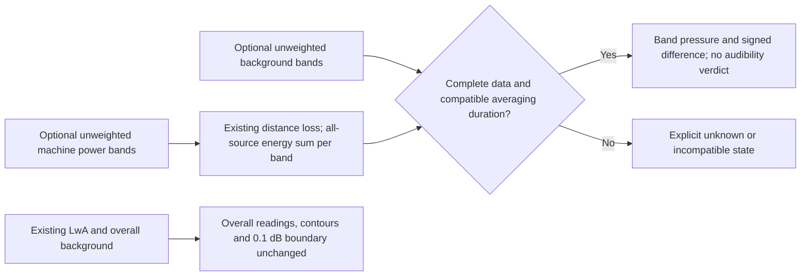

# Optional frequency-band foundation

[Model guide](model.md) · [Feasibility review](model-feasibility.md) · [Task 026](tasks/026-feasible-propagation-effects.md)

The owner selected this slice on 19 November 2026. It adds unweighted octave evidence and
receiver comparisons using the existing geometric spreading equation. It does not calculate
masking, hearing distance, atmospheric absorption or a new contour field.

## Separate quantities

| Input | Meaning | Reference |
| --- | --- | --- |
| Existing `lwa` | Overall A-weighted machine power; still drives all existing overall results and contours | 1 pW |
| Machine `spectrum.levels` | Unweighted energy-average sound power in each band | 1 pW |
| `background_spectrum.levels` | Unweighted energy-average background pressure in each band | 20 µPa |
| Existing `background_db` | Overall A-weighted background for the 0.1 dB display boundary | 20 µPa |

No conversion or consistency reconciliation between unweighted bands and overall LwA is
performed. Both inputs remain explicit evidence; no A-weighting coefficients, frequencies,
cloud corrections or representative spectrum are invented. Missing fields do not block
ordinary POC use. Presets have no spectral data.

## Optional evidence object

Machine types and saved machine types accept nullable `spectrum`; the scenario/save accepts
nullable `background_spectrum`. Each supplied object has:

- `levels`: exactly nine entries on the fixed grid **31.5, 63, 125, 250, 500, 1,000, 2,000,
  4,000 and 8,000 Hz**, in that order. Finite negative/zero values are levels; `null` is unknown.
- `period_s`: positive finite energy-averaging duration, or null for unknown.
- `weighting`: `"Z"` only (unweighted); `metric`: `"Leq"` only (energy-average basis).
  This basis flag does not convert a pressure measurement into source sound power.
- `provenance`: `"example"` (assumed) or `"measured"`, entered by the user, not certified.
- `reference`: up to 500 characters of plain text describing source/operating/measurement basis.

Blank evidence remains null. Complete and partial evidence is retained by version-1 Save/Open
and recovery; old scenes default to no spectrum. Wrong grid length, non-finite values,
non-numeric levels, unsupported weighting/metric and non-positive durations are rejected.
A fixed grid makes the frequency labels explicit; this is not an arbitrary-spectrum importer.

## Calculation and output

`POST /api/predict` retains its existing `receivers` unchanged. When any active machine has
spectral evidence or a background spectrum is supplied, it also returns `band_results`, keyed
by receiver ID, containing nine rows. Otherwise `band_results` is an empty object.

For each band, subtract the existing full-space distance loss from every source's unweighted
band power, then add **all** source energies. Only complete source bands with known matching
averaging durations produce a machine total. A comparison additionally requires background
for that band with the same duration. Matching duration is necessary, not proof of the same
operating conditions or representative measurements; the reference must be checked.

Each row contains `frequency_hz`, `machine_db` (receiver pressure), `background_db`, signed
`difference_db` (machine minus background), `status`, `missing_sources` and `near_field`.
Missing totals/differences are null, never a false zero or a partial sum. The existing 1 m
numerical clamp and near-field flag apply. Bands are independent; one missing band does not
remove complete results from other bands.

| Status | Meaning |
| --- | --- |
| `ok` | Complete all-source band total and compatible background comparison |
| `missing_source_data` | At least one source lacks this band or its averaging duration; source IDs retained |
| `missing_background` | Complete compatible source total, but no background band |
| `incompatible_basis` | Source durations disagree, or background duration differs/is unknown; no signed comparison |
| `no_sources` | No machines, not zero ambient noise |
| `unavailable` | Signed difference is outside finite numerical representation |

A positive difference does not mean audible; a negative difference does not mean inaudible.
These comparisons are independent of the overall 0.1 dB relevance filter. No bands are
inferred from the existing overall background or from the humorous sound guide.

## Verification

`tests/test_bands.py` checks independent intensity references at 100/200 m, equal-source
energy addition, unknown-source isolation, temporal mismatch, near-field/no-source cases,
negative inputs, invalid spectra, extreme finite differences, save round-trips and unchanged
overall prediction/contour output. Full backend suite: **160 passed**. Ruff check/format and
Pyright passed. No third-party dependency or reference dataset was added.
