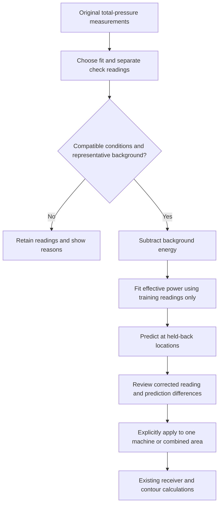

# Estimates from field measurements

[Machine task 032](tasks/032-machine-measurement-calibration.md) ·
[Area task 033](tasks/033-operating-area-estimate.md) · [User guide](user-guide.md)

The owner extended task 031's record-only scope on 19 November 2026. Recording a measurement
still never changes the model. A separate **preview, review, apply** action can now derive an
effective emission from selected readings. This is a POC fit to the existing full-space
spreading model, not independent proof of real sound power, audibility or environmental accuracy.

For collecting the inputs, use the [field-measurement guide](field-measurement-guide.md).

## Eligibility and background

Both workflows require known stationary LAeq averages, positive duration, one matching
activity/site-state label and a user-confirmed representative scenario background on a
comparable averaging basis. Text labels do not prove comparable physical operation. Background
is not inferred from the lowest reading. Meter capability and field suitability remain human
inputs. No unknown duration/metric/isolation is invented.

For total pressure T and background B, corrected source pressure is
`T + 10 log10(1 − 10^((B−T)/10))`, evaluated with `expm1` for stability. The agreed screening
rules are: below 3 dB separation, retain but reject for fitting; 3–10 dB, allow with a sensitivity
caution; above 10 dB, allow the correction. These are pragmatic data-selection rules, not
instrument uncertainty bounds or regulatory acceptance criteria. If background is unknown,
record observations but do not fit. A later background change invalidates an uncommitted
preview; already applied fits retain the background snapshot and do not refit automatically.

Machine mode additionally requires `isolation: isolated`, a matching source ID, recorded
position/type and operating-mode context. Mixed/unknown tests can instead support area mode.
The fit ignores the old power being replaced; it never subtracts predicted other machines.
Machine moves or mismatched setup prevent the fit. The operator must actually isolate the
machine for the observations; other sources may be active later in a prediction scenario.

Area mode needs no source link or existing machine. The user fixes the equivalent centre and
circular radius. Readings inside/on the circle are retained as context, not fitted. The circle
is a footprint marker, not a barrier or a distributed emission model. Outside readings can
still be too close for the equivalent-point approximation; check multiple distances/directions.
Predictions within the operating area are particularly unsuitable for this simplification.

## Fitting and checking

Select at least two Fit readings and one Check-only reading. Locations must be at least 1 m
apart, and outside the source's 1 m numerical clamp. This prevents duplicated locations from
serving as a separate check; it does not establish statistical independence or sufficient
coverage. No fixed count guarantees a reliable town prediction.

For each training point, infer `effective LwA = corrected LpA + 20 log10(r) + 10 log10(4π)`.
Take the arithmetic mean of these inferred dB powers: this minimizes equally weighted squared
pressure-dB residuals for a fixed location. It is not an average of equipment powers over an
operating cycle, nor a measured maximum sustained town level. Check readings never enter the
fit. Their displayed difference is **background-corrected observation minus fitted prediction**,
not measured total minus machinery prediction. A zero difference on synthetic data does not
validate real-world propagation. Training spread is the range of inferred powers, not a
confidence interval. No automatic fit-quality/pass-fail threshold is invented.

All explicitly selected readings must be eligible; failures are listed rather than silently
excluded. Users can change a role to Don't use and preview again. Extreme fits outside the
existing 0–300 dB emission-input range return a reason, without clamping. Original pressure
readings, including negative values, are preserved.

## API and storage

`POST /api/measurements/fit` accepts `FitRequest`: the current scenario, observations,
`source_modes`, `mode`, `source_id` or `centre`/`radius_m`, `activity`, `background_confirmed`,
`fit_ids` and `check_ids`. The response contains `ready`, `reason`, optional `lwa`/`spread_db`,
centre and per-selected-reading roles, eligibility, corrected pressure and check predictions.
It is read-only and distinct from `/api/measurements/compare`.

Saved observations add optional `isolation` (`unknown`, `isolated`, `mixed`), default Unknown
for old files. Saved catalogue entries add optional `fitting` evidence, default null. It
retains a detached request/result snapshot and method `full-space-log-fit-v1`; ordinary
prediction requests strip this metadata. No new dependency or external service is used.
Applying calibration creates a derived catalogue type for one placed instance; other shared
instances and the original entry stay unchanged. Bands are not inferred or inherited as
measured data. Applying an area places one equivalent source and asks which existing map sources its readings include. It replaces those placements and retains independent sources. Coverage is a field judgement and does not change the fitted power. Receiver and contour equations are unchanged. The derived
power is marked as an estimate, with the measured origin described in its note; it is not
labeled as directly measured sound power. Saved evidence remains historical after manual edits.

Neither apply action alters observations, background, receivers or contour thresholds.
History is reset at the catalogue-reference change, as for other reference-boundary operations;
this is not a new calibration undo system. Save a named scenario to retain the resulting state.

## Verification

`tests/test_measurement_fitting.py` uses independent synthetic intensities, not real site data.
It covers recovered power, held-out independence, stable energy subtraction, sensitive/dominated
readings, unknown/mixed/test-basis exclusions, changed contexts, distinct locations, source-free
area mode, stored evidence and the API. UI and screenshot evidence lives in tasks 032–033.
