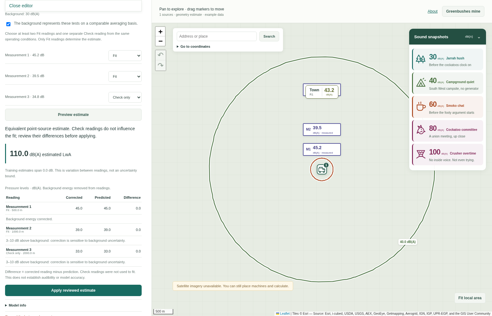

# Measurement workflow review — 19 November 2026

[Machine calibration](tasks/032-machine-measurement-calibration.md) ·
[Operating-area estimate](tasks/033-operating-area-estimate.md)

The owner asked to work through the next task after the approved queue was implemented.
This follow-up reviews the existing measurement → estimate → town-prediction workflow,
fixing bugs and confusing interactions without adding propagation features or a new task brief.

Reviewed base: `812a43b` (PR #59). Fix/test commit: `ba2890a`.

## Findings addressed

| Finding in the reviewed base | Result |
| --- | --- |
| Required: changing from area to machine mode left area placement active, so subsequent map clicks still entered an area centre | Changing modes cancels only area-centre placement; other placement modes remain intact |
| Required: unnamed preview rows all said Measurement, making failed/check readings ambiguous | Preview labels use the same original Measurement 1, 2, … numbering as the records, including skipped rows |
| Usability: machine choices showed opaque ID fragments instead of map identities | Choices use the actual map number and name; filtering out area sources does not renumber machines |
| Usability: manually retyping exact operating labels invited mismatches; whitespace names/activity reached an unusable preview or generic API error | Existing activities appear as native suggestions; blank/whitespace inputs are rejected locally with a field message |

No equations, eligibility/background policy, fit/check independence, source powers, saved
schema or dependencies changed. Suggestions remain optional free-text input; they do not
assign operating conditions automatically. Source and measurement IDs still identify data
internally. These are defects/usability gaps in the reviewed base, not introduced regressions.

## Verification

- `uv run pytest`: **214 passed**. Ruff check/format, Pyright and pinned 25-skill integrity passed.
- **225 plain-browser checks** across 14 fixtures. New `fitting-workflow.html` has 19 checks;
  the 13 existing fitting/shared-state fixtures still pass their 206 checks.
- New checks cover placement cancellation without cancelling unrelated modes, map numbering
  after an area entry, literal/deduplicated activity suggestions, preserved selected roles,
  whitespace correction, no invalid API calls, valid previews and stale Apply removal.
- Reversed the placement condition temporarily: the new fixture failed specifically on
  “switching away from area cancels map placement”. Restored the code and reran all 225 checks.
- Real-app Chromium verified the reproduced placement bug, corrected map instructions,
  numbered picker, suggestions, zero fitting requests for invalid activity, and numbered
  rows returned through the real fitting endpoint. No page errors or horizontal overflow at
  390 px. Full fitting regression also passed isolated application, mixed rejection,
  source-free area fitting, stale-response rejection, Save/Open/recovery, readable stored
  evidence and zero acoustic calls on map navigation.
- Local documentation links and `git diff --check` passed.

Captured and inspected:

[Field validation](images/measurement-review/fitting-review-validation.png) ·
[390 px preview](images/measurement-review/fitting-review-numbered-narrow.png)

All measurements are fictional references. Satellite imagery was unavailable, so screenshots
show the grid fallback. Review and testing were performed by the author; no independent
reviewer, real meter/site validation or audibility certification is implied. Human merge
review remains required. The equivalent-point area model's physical limitations remain as
recorded in the [fitting method](measurement-fitting.md).
