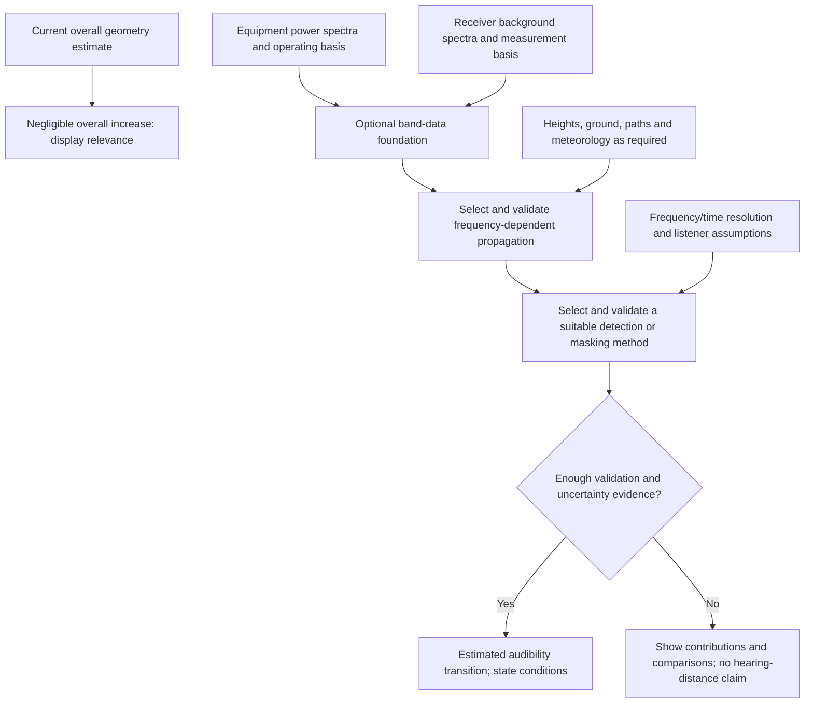

# Which sound-model improvements are feasible?

[Current model](model.md) · [Task 026](tasks/026-feasible-propagation-effects.md)

**Feasibility review — 19 November 2026.** The owner subsequently selected the optional
[band-data foundation](frequency-band-contract.md), now implemented separately. The proposals
below preserve the original review context. No audibility or atmospheric method is
implemented by this review. The current calculation remains independent point-source
spreading, with the owner-approved 0.1 dB overall-increase display boundary.

## Recommendation

Keep that boundary labelled **Negligible overall increase**. It is not a maximum hearing
distance. Before adding an audibility boundary, obtain equipment **sound-power spectra**
and matching **background pressure spectra**, plus a suitable propagation and detection
method. A single A-weighted number cannot supply the missing frequency information.

The smallest useful next increment is an **optional octave-band evidence contract and
receiver-only band calculation**, using the existing geometric equation. It would expose
frequency-specific contributions and differences from background without declaring them
heard or inaudible. It would not change existing totals, contours or the 0.1 dB rule.
The owner must select this slice before implementation; no new task or dependency has
been added automatically. If suitable band data cannot be obtained, retain the current POC
rather than invent spectra or an audibility threshold.

## What we have

- Equipment: one overall LwA value, provenance, estimate note, source reference and operating
  mode. Presets are guesses; no measured equipment spectra were found in the repository.
- Locations: horizontal map coordinates; no ground elevations, source/receiver heights,
  terrain mesh or barrier geometry.
- Background: one optional overall LpA value for the scenario; no frequency bands or measured
  temporal distribution. This is now supported, rather than a missing feature.
- Weather: cloud percentage as metadata, without wind/temperature/humidity propagation.
- Engine: Python, NumPy and ContourPy; a scalar reference, all-source energy addition and
  contour validation. These tools do not provide environmental physics on their own.

## Options and required evidence

Effort is relative engineering scope, not a delivery estimate. **Small** is a bounded POC
slice; **medium** needs a dedicated validation/data contract; **large** is a different model
or substantial site-data integration. R1/R2 are the sources read below, not full standards
implementations or endorsement of mine predictions.

| Addition | Required inputs | Method and limits | Evidence / effort / dependencies |
| --- | --- | --- | --- |
| Verified emission powers and spectra | Equipment sound-power bands, operation/time basis, reference and whether measured/assumed | Do not enter receiver pressure as power or infer bands from LwA. Optional band baseline is the recommended first slice; geometry alone still omits site physics. | R1 power/filtering; small contract + scalar evaluator, existing Python |
| Background comparison | Comparable background pressure bands and measurement basis, ideally without target machines | Per-band source/background differences; a difference is not a detection verdict. Keep the entered overall background for the existing display rule. | R1 weighting; R2 ambient/measurement practices; medium after data collection |
| Heights / 3D separation | Source/receiver elevations on a common datum, or heights plus ground elevations | Locally `r = sqrt(horizontal² + Δheight²)`. An assumed-flat-ground option must be explicit. This does not model shielding or reflections; surface distance plus height is not a global ray model. | R1 spreading; small local geometry slice, standard math; benefit mostly near sources |
| Atmospheric absorption | Bands, temperature, relative humidity, pressure and path length | Frequency-dependent attenuation from a selected documented method, e.g. ISO 9613-1. No representative-frequency guess or universal dB/km value. | R2 cites relevant standards; medium; full reference/validation basis still needed; no library approved |
| Directivity | Frequency/direction-dependent equipment data, source orientation | Apply documented directional power factors with a defined energy-normalisation convention. No guessed benefit for pointing a truck away. | R1 source/field distinction; medium; manufacturer evidence needed |
| Ground/reflections | Heights, ground properties, frequency bands, installation assumptions | Select a ground model; ground can change phase/reflections as well as attenuation. A blanket −3 or +3 dB is not a general ground model. | R2 discusses loss of soft-ground effects around barriers; medium/large; no dataset approved |
| Terrain, pits, buildings and barriers | Reliable elevation/obstacle geometry, heights, surface data and bands | Determine valid paths, diffraction/reflection and visibility with a selected environmental method. A satellite image is not an elevation model. | R2 barrier/ground measurement discussion; large; GIS data/engine and licences need separate review |
| Wind and temperature refraction | Spatial/height profiles or a method's documented meteorological class, source/receiver geometry | Select valid propagation assumptions; cloud cover alone cannot bend a ray or justify a dB correction. Do not extrapolate measurement wind limits into a propagation formula. | R2 meteorological documentation; large; missing data/model |
| Operating cycles | On/off fractions and sound powers for the same averaging period, operating states | Energy-weighted average, `10 log10(sum(fraction × 10^(level/10)))`. Do not use duty-cycle averages to represent maxima or alarms. | R1 logarithmic energy and exposure/time distinction; small/medium; explicitly separate metric first |
| Sound character / audibility | Adequate spectral/time resolution, background, propagation, listener/detection assumptions | Choose and validate a detection/masking method. Octave bands alone may be too coarse for a narrow reversing tone. No automatic `machine < background ⇒ inaudible` rule. | R1 frequency/loudness dependence; large validation task; method not selected |
| Uncertainty | Evidence-based input/model variability and independent comparisons | Report supported ranges or sensitivities; validate before assigning probabilities. Do not paint an arbitrary-width transition zone and call it confidence. | R2 measurement/model validation distinction; medium/large; no uncertainty distribution available |

Cloud correction, invented spectra, universal absorption and a regulatory pass/fail boundary
are excluded. Adding more terms is only useful when their inputs and validation are credible.

## Why the overall background cannot decide audibility

A small numerical experiment used two synthetic **already A-weighted energy bins**, not
claimed equipment measurements or a masking model. Missing machine energy in a bin is zero
energy, not a fabricated 0 dB measurement.

| Quantity | Background A | Background B |
| --- | ---: | ---: |
| Background bin 1 | 5 dB | 45 dB |
| Background bin 2 | 45 dB | 5 dB |
| Overall background from energy addition | 45.000434 dB(A) | 45.000434 dB(A) |
| Machine contribution in bin 1 only | 29 dB | 29 dB |
| Machine minus background in bin 1 | +24 dB | −16 dB |
| Overall increase | 0.107732 dB | 0.107732 dB |

The existing overall calculation produces the same result in both cases, while the active
frequency's source/background difference changes by 40 dB. That proves information is
missing; it does **not** prove either case audible or inaudible. Auditory masking can cross
frequency bands, and tonal/time behaviour and listener conditions still matter.

Reproduce with the current Python environment; no extra package is needed:

```sh
uv run python - <<'PY'
import math
for bins in ([5, 45], [45, 5]):
    background = 10 * math.log10(sum(10 ** (level / 10) for level in bins))
    increase = 10 * math.log10(1 + 10 ** ((29 - background) / 10))
    print(background, 29 - bins[0], increase)
PY
```

## Proposed first increment: optional band evidence and scalar receiver results

**Proposed only.** Keep this separate from atmospheric absorption and from any audibility
contour. It is a data foundation with a transparent baseline, not a validated hearing model.

### Input and output contract

- Optional equipment spectra use **unweighted octave-band Lw in dB re 1 pW**, with explicit
  centre frequencies. An initial common grid of 31.5/63/125/250/500/1,000/2,000/4,000/8,000 Hz
  follows octave centres described in R1. It is not sufficient resolution for every tone.
- Optional background spectra use **unweighted octave-band Lp in dB re 20 µPa**, on the
  same grid. Initially one background spectrum applies uniformly to the scenario, based
  on the selected receiver's measurement; this spatial assumption must be explicit.
- Store the measurement/assumption classification, reference and operating/averaging basis.
  Reuse existing source-reference/operating-mode information where possible. Source power
  and background pressure remain distinct quantities, not interchangeable level arrays.
- Missing bands are unknown, never zero dB or zero energy. Do not reconstruct a spectrum
  from LwA, duplicate overall background into every band, or silently drop sources without
  spectral data. Preserve incomplete evidence, but mark the band calculation unavailable.
- For complete compatible inputs, calculate each receiver band by the existing full-space
  geometric equation and sum **all source energies within that band**. Return band pressure
  totals, corresponding background levels and signed band differences, labelled geometry-only.
  Do not turn the sign into an audible/inaudible state.
- Existing LwA calculations, map contours, saved legacy scenes and overall-background rule
  retain their exact behaviour. Do not silently derive/overwrite LwA from the new unweighted
  data or mix unweighted bands into the A-weighted total. A-weighting reconciliation needs
  a separately verified coefficient/reference basis; none is adopted in this review.
- No new service or library is required for the data contract and scalar arithmetic. No
  spectral contour grid or new map boundary is included. Missing spectra do not prevent
  ordinary POC use.

This first increment needs optional fields and validation in the existing saved/request
schemas, a small band evaluator and a compact evidence editor/result view. If that grows
beyond one reviewable slice, separate the compatible data contract from its UI/evaluator.
Do not add those implementation tasks until the owner selects the approach.

### Validation contract

| Check | Independent expected result / boundary |
| --- | --- |
| Omit all new fields | Current scalar results, geometry/cache behaviour and save/recovery remain unchanged |
| Complete one-band analytical fixture | Lw 100 dB at 100 m gives Lp 49.007901 dB in that band, derived from `W/(4πr²)` |
| Double distance | Each band drops 6.020600 dB with geometry-only propagation |
| Two equal independent sources | Each band rises 3.010300 dB; retain both source IDs |
| Different spectra with equal overall energy | Preserve the different band results; do not collapse to one invented spectrum |
| Equal source/receiver position | Retain the 1 m numerical clamp and near-field warning; do not claim near-field accuracy |
| Missing source/background band | Explicit incomplete/unavailable comparison; no partial total presented as complete |
| Unknown frequency, weighting or reference units | Reject for calculation with a readable reason, preserving accepted evidence where supported |
| Zero, negative and non-finite band values | Zero/negative dB are valid levels; NaN/Infinity rejected; missing is distinct |
| Save/Open, recovery, names, all-source addition | Exact spectral/evidence round-trips; no source filtering; presentation-only actions stay local |
| Claimed tone detection or masking | Remains unsupported, even with a full octave spectrum, until a suitable method is validated |

The analytical cases above were calculated independently in this review; they are future
acceptance references, not evidence that the proposed band evaluator already exists.

## Route to an estimated audibility boundary



A shaded transition is appropriate only when its width has a documented uncertainty or
detection-probability basis. A source-specific audibility boundary must also consider masking
by other machines and which machine is being assessed; the current combined-noise contours
do not answer that question. An exact universal maximum hearing distance is not promised.

## Sources read and limits

**R1.** [OSHA Technical Manual, Section III, Chapter 5](https://www.osha.gov/otm/section-3-health-hazards/chapter-5),
read 19 November 2026: Sound Fields; Sound Power; Filtering/Octave Bands (including the band
centre table); Loudness and Weighting Networks; pressure/power and logarithmic energy
principles. These support quantities, frequency dependence and baseline arithmetic, not
mine-to-town audibility limits or WA compliance. Occupational exposure limits are not used
as environmental criteria.

**R2.** [FHWA Noise Measurement Handbook](https://www.fhwa.dot.gov/environment/noise/measurement/handbook.cfm),
read 19 November 2026: ambient/site measurement documentation, meteorological conditions,
atmospheric-absorption discussion in the measurement guidance, and ground/barrier measurement
context. The handbook notes temperature/humidity dependence and cites SAE/ANSI/ISO absorption
methods; it is a highway measurement reference, not an industrial-mine propagation engine or
audibility algorithm. Its measurement wind guidance is not adopted as a weather correction.

The [ISO 9613-2 landing-page request](https://www.iso.org/standard/74047.html) returned HTTP 403;
[NPL's atmospheric-absorption guide](https://resource.npl.co.uk/acoustics/techguides/absorption/)
returned HTTP 503. Neither full reference was read, and no ISO/NPL formula, coefficients,
certification or validated implementation is claimed. Full method text/reference cases and
licensing must be checked before adopting one. Existing library candidates in
[library options](library-options.md) remain unapproved for installation.

Repository inspection covered `acoustics.py`, `types.py`, `scope.py`, saved-document types,
source presets and the current model guide. Numerical experiments used fictional values
and the existing Python stack, without changing app predictions. Engineering effort and
selection are recommendations; no site measurements or independent environmental validation
were available. No independent reviewer was used.
