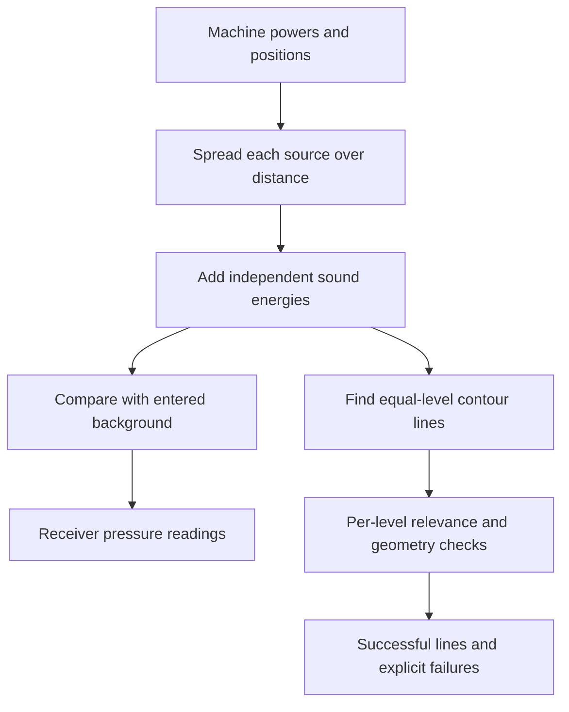

# How the sound model works

[Documentation index](README.md) · [Technical implementation](../ARCHITECURE.md)

The app estimates the contribution of independent machines at listening locations. It is a
starting point for exploring a scenario, not proof that machinery will be inaudible in town.



## Sound power and pressure are different

**LwA** describes the equipment's A-weighted sound power, referenced to 1 picowatt.
**LpA** describes A-weighted pressure at a receiver, referenced to 20 micropascals.
Both are expressed in decibels, but the same number does not mean the same quantity.
A manufacturer's value must be checked to determine which quantity and operating condition
it describes before entering it as machine power.

## Distance reduces the idealised level

For each source the app uses full-space, omnidirectional spreading:

```text
LpA = LwA - 20 log10(r / 1 m) - 10 log10(4π)
```

Here `r` is horizontal great-circle distance. The calculation uses at least 1 m to avoid a
singularity and flags nearer receivers. That limit does not model near-field physics.
Source/receiver heights and the actual 3D propagation path are not represented.

For one source, doubling distance reduces its predicted contribution by about **6 dB**.
For example, a 100 dB(A) LwA source produces about 49 dB(A) LpA at 100 m and 43 dB(A) at
200 m under this equation. These are analytical examples, not measured equipment evidence.

## Machines combine by energy

Decibels are logarithmic. Two independent 40 dB(A) contributions at the same receiver combine
to approximately **43 dB(A)**, not 80 dB(A). The model adds energy, then converts back:

```text
LpA_total = 10 log10(sum(10 ** (LpA_i / 10)))
```

Outer contours may merge while inner contours form separate lobes. That is the shape of the
combined energy field. Ordinary independent machinery inputs do not support coherent wave
cancellation, and this model does not calculate phase interference.

## Negative decibels are possible

Zero dB is a reference level, not an absence of sound. A pressure level of −20 dB corresponds
to 2 micropascals. Energy remains positive. The app does not clamp legitimate negative
receiver levels to zero, but a tiny extrapolated value is not evidence of actual audibility.

## Adaptive background boundary

Enter one A-weighted background pressure level for the whole scenario. No background is
assumed for new or legacy scenes. With background blank, receivers show the unfiltered
machinery estimate at any distance. Numeric contour thresholds have no fixed lower or upper
cap, including negative values; non-finite values remain invalid.

The app adds **all machinery energies first**, then evaluates their increase over background:

```text
increase = 10 log10(1 + 10 ** ((machinery_level - background_level) / 10))
boundary_level = background_level + 10 log10(10 ** (0.1 / 10) - 1)
               ≈ background_level - 16.327747 dB
```

A dotted contour at that exact machinery level marks a **0.1 dB increase**. Lower machinery
contours are labelled **Negligible increase** and not drawn. Receivers below the boundary
show the same phrase instead of numeric totals or contribution breakdowns. Numeric readings
and other contours continue to describe machinery alone; background is never added to the
reported machinery level. At the threshold, the increase is 0.1 dB; below it, it is less.

For example, background 40 dB(A) produces an outer threshold of approximately 23.7 dB(A).
A 120 dB(A) source's geometry-only boundary is about 18.5 km away; changing machine power,
source count/positions or background changes the boundary automatically. The display rule
uses neither a fixed distance nor an absolute machinery-pressure threshold.

This owner-selected **display relevance** setting is not a test of inaudibility or compliance.
A distinctive tone can remain noticeable; broadband background alone does not describe
masking. Use compatible A-weighted metrics and averaging periods, and distinguish measured
background from assumptions. Propagation remains geometry-only and is not a guaranteed upper
bound. Extreme inputs such as 300 dB(A) remain experimental arithmetic, not explosion models.

Contours retain a 640,000-cell budget per level and supported ±85° map projection. The old
200 km domain-radius cap and 10 km display suppression are removed. An unrepresentable
complete domain reports a named failure rather than a clipped line; successful other levels
and receiver estimates remain available. The separate 10 km pairwise navigation rule is unchanged.

The [scope review](scope-policy-review.md) preserves the earlier options and records the
owner's approved replacement. See [task 024](tasks/024-source-aware-model-scope.md) for checks.

## What is missing

| Missing input or effect | Why it matters |
| --- | --- |
| Verified equipment data, operating mode and spectra | A guessed emission may not represent the machine or activity |
| Ground, terrain, pits, buildings and barriers | Real paths can reflect, absorb, shield or diffract sound |
| Wind, temperature, humidity and atmospheric absorption | Weather and frequency change outdoor propagation |
| Source/receiver heights and directivity | Installation and direction affect the received level |
| Spatial background measurements, duty cycles, sound character and uncertainty | A source contribution alone cannot establish disruption or compliance |

Cloud cover is saved as metadata and has **no numerical correction**. A universal cloud-to-dB
multiplier would not account for these missing effects. Colours and the humorous sound guide
are not acceptable-noise criteria.

For due diligence, agree criteria and receivers, obtain appropriate source/background data,
select a suitable propagation method, validate against independent measurements, and have
the assessment reviewed. The [existing assessment themes](tasks/README.md) describe that work.
