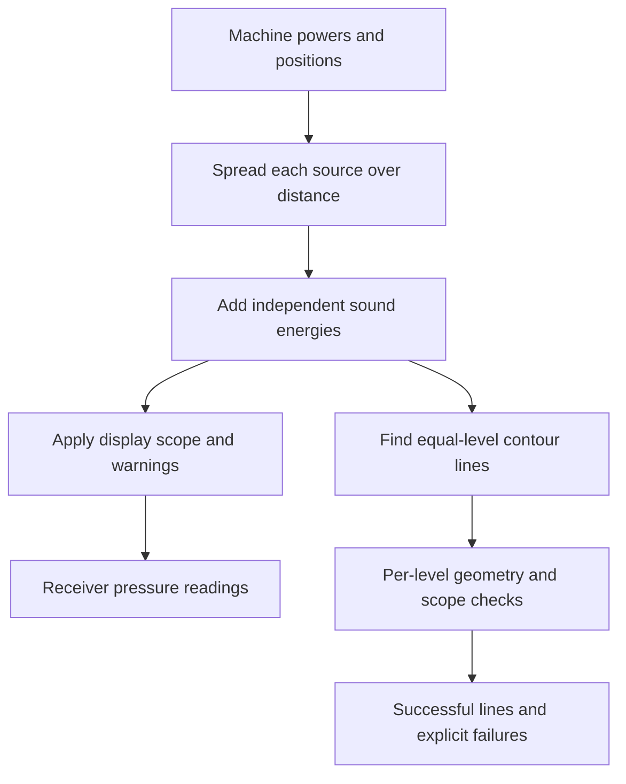

# How the sound model works

[Documentation index](README.md) · [Technical implementation](../ARCHITECURE.md)

The app estimates the contribution of independent machines at listening locations. It is a
starting point for exploring a scenario, not proof that machinery will be inaudible in town.



## Sound power and pressure are different

**LwA** describes the equipment's A-weighted sound power, referenced to 1 picowatt.
**LpA** describes A-weighted pressure at a receiver, referenced to 20 micropascals.
Both are expressed in decibels, but the same number does not mean the same quantity.
A manufacturer's value must be checked to determine which quantity and operating condition
it describes before entering it as machine power.

## Distance reduces the idealised level

For each source the app uses full-space, omnidirectional spreading:

```text
LpA = LwA - 20 log10(r / 1 m) - 10 log10(4π)
```

Here `r` is horizontal great-circle distance. The calculation uses at least 1 m to avoid a
singularity and flags nearer receivers. That limit does not model near-field physics.
Source/receiver heights and the actual 3D propagation path are not represented.

For one source, doubling distance reduces its predicted contribution by about **6 dB**.
For example, a 100 dB(A) LwA source produces about 49 dB(A) LpA at 100 m and 43 dB(A) at
200 m under this equation. These are analytical examples, not measured equipment evidence.

## Machines combine by energy

Decibels are logarithmic. Two independent 40 dB(A) contributions at the same receiver combine
to approximately **43 dB(A)**, not 80 dB(A). The model adds energy, then converts back:

```text
LpA_total = 10 log10(sum(10 ** (LpA_i / 10)))
```

Outer contours may merge while inner contours form separate lobes. That is the shape of the
combined energy field. Ordinary independent machinery inputs do not support coherent wave
cancellation, and this model does not calculate phase interference.

## Negative decibels are possible

Zero dB is a reference level, not an absence of sound. A pressure level of −20 dB corresponds
to 2 micropascals. Energy remains positive. The app does not clamp legitimate negative
receiver levels to zero, but a tiny extrapolated value is not evidence of actual audibility.

## Why the app hides distant numbers

With geometric spreading alone, a 120 dB(A) LwA source still produces about 2.42 dB(A) at the
roughly 213.57 km from Greenbushes to Perth. That mathematical result does not establish that
someone can hear the machine there. Important propagation effects and background masking
are absent.

The app currently applies a **10 km display scope**. The owner has requested a replacement
that better distinguishes source plausibility and unsupported distant extrapolation;
the [backlog](tasks/README.md) records that investigation. Until implemented,
the current behaviour is:

| Situation | Current behaviour |
| --- | --- |
| Receiver more than 10 km from every source | Hide numeric level and contribution breakdown; show Outside scope |
| Receiver within 10 km, with some more distant sources | Keep all contributions and warn that distant paths are unvalidated |
| Calculated contour extends outside the nearest-source 10 km scope | Reject the entire level with a reason; keep other successful levels |

This is a presentation policy, **not a physical sound cutoff or a validated operating range**.
Even predictions inside 10 km are unvalidated. The separate 200 km contour domain guard is
computational; it does not expand the display scope.

## What is missing

| Missing input or effect | Why it matters |
| --- | --- |
| Verified equipment data, operating mode and spectra | A guessed emission may not represent the machine or activity |
| Ground, terrain, pits, buildings and barriers | Real paths can reflect, absorb, shield or diffract sound |
| Wind, temperature, humidity and atmospheric absorption | Weather and frequency change outdoor propagation |
| Source/receiver heights and directivity | Installation and direction affect the received level |
| Background noise, duty cycles, sound character and uncertainty | A source contribution alone cannot establish disruption or compliance |

Cloud cover is saved as metadata and has **no numerical correction**. A universal cloud-to-dB
multiplier would not account for these missing effects. Colours and the humorous sound guide
are not acceptable-noise criteria.

For due diligence, agree criteria and receivers, obtain appropriate source/background data,
select a suitable propagation method, validate against independent measurements, and have
the assessment reviewed. The [existing assessment themes](tasks/README.md) describe that work.
