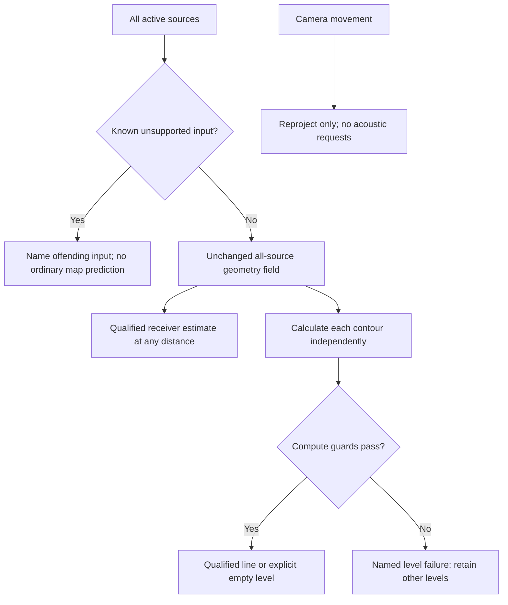

# Proposed display policy: geometry estimates without a distance cutoff

[Current model](model.md) · [Task 024](tasks/024-source-aware-model-scope.md)

**Proposed, 18 November 2026. Owner decision pending.** This review changes no app behaviour.
Reviewed baseline: `29ae47f` (main, including task 030).

The current equation cannot decide whether machinery can be heard. It can calculate an
idealised contribution. Replacing the 10 km limit with another distance or an invented
attenuation term would not resolve that gap. The smallest useful change is to present the
calculation as a **geometry estimate**, retain real computation limits, and handle known
unsupported inputs separately. This allows exploration beyond 10 km without calling the
result a hearing prediction.

## What the current app actually does

| Layer | Current rule | Consequence |
| --- | --- | --- |
| Receiver | `screen_receiver` hides the whole numeric result when every source is over 10 km away | A result disappears at 10,001 m despite almost no change in calculated pressure |
| Mixed paths | A nearby source permits a total containing all distant sources | A very quiet nearby machine can change display eligibility without meaningfully changing the total |
| Contour | `lines_within_scope` samples vertices/midpoints; one sample beyond 10 km from every source rejects the whole level | A complete, computed line can be rejected solely by display policy |
| Slider | Lower bound uses total source power at 10 km, then verifies endpoints through the contour engine | Removing only the line check would leave the slider artificially restricted |
| Compute | 200 km total-power bounding radius, ±85° projected domain and 640,000 charged cells per level | These are safety limits, not evidence of physical validity |
| Navigation | Every pair of objects in the fitted group must be within 10 km | Camera rule; independent of sound and unchanged by this proposal |

The contour radius guard bounds the domain using the **combined sound power**, rather than
measuring each actual contour's radius. Widely separated sources and mixed powers can hit
other budget limits even when an individual visible lobe looks small. Do not silently crop
lines or drop sources to get around those limits.

## Reproduced examples

All inputs below are fictional. A 120 dB(A) LwA entry represents a haul-truck-like example,
not measured fleet evidence. A 130 dB(A) entry is a louder aggregate plant-like example,
not a confirmed machine or proof of audibility at any distance.

Independent reference, with distance `r` in metres:

```text
LpA = 10 log10(10 ** (LwA / 10) / (4πr²))
r_contour = sqrt(10 ** ((LwA - contour_level) / 10) / (4π))
```

The first expression agreed with `source_level` to less than 1e-10 dB in 21 cases
(120/130/300 dB(A), each at 100/1,000/10,000/10,001/15,000/30,000/300,000 m).
This checks arithmetic, not outdoor propagation.

| Distance | 120 dB(A) LwA | 130 dB(A) LwA | Current receiver display |
| --- | ---: | ---: | --- |
| 100 m | 69.01 | 79.01 | Numeric |
| 1 km | 49.01 | 59.01 | Numeric |
| 10 km | 29.01 | 39.01 | Numeric |
| 10.001 km | 29.01 | 39.01 | Outside scope |
| 15 km | 25.49 | 35.49 | Outside scope |
| 30 km | 19.47 | 29.47 | Outside scope |
| 300 km | −0.53 | 9.47 | Outside scope |

Values are **LpA dB(A)**. Neither a positive nor a negative value decides audibility.
The 300 km haul-truck result is an unsupported long-path extrapolation, not evidence that
someone can hear it. Conversely, the 15 km louder-source result cannot be dismissed merely
because it lies beyond 10 km. Missing absorption, ground, weather and masking prevent a
credible hearing estimate in both cases; the equation is not a guaranteed upper bound.

Additional checks using the real baseline modules:

- Two colocated 120 dB(A) sources at 15 km combine to **28.50 dB(A)**, not 50.97.
- A 120 dB(A) source at 1 km plus a 130 dB(A) source at 15 km totals **49.20 dB(A)**.
  Both contributions must remain in the sum; neither camera clusters nor display policy
  should filter sources.
- For one 130 dB(A) source, a **30 dB(A)** contour has analytical radius **28.21 km**:
  currently rejected by the 10 km policy. Its 40 and 60 dB(A) levels succeed.
  The slider currently starts at **39.1 dB(A)**, so that 30 dB(A) line is also outside its range.
- For one 120 dB(A) source, requested levels **0/10/30/40/120** yield
  **failed/failed/ok/ok/empty**. The 0 dB(A) radius is 282.09 km and exceeds the compute
  guard; the 10 dB(A) radius is 89.21 km and fails display scope. The highest level is
  unreachable under the 1 m clamp. These are three different reasons, not silence.
- At **300 dB(A) LwA**, the equation returns **205.49 dB(A)** at 15 km. The current
  engine even draws 210 and 220 dB(A) contours within 10 km. That input corresponds to
  **10¹⁸ W of A-weighted reference-equivalent power** (`10⁻¹² × 10³⁰`), and must be
  treated as a stress example outside ordinary machinery/linear point-source use. It is
  not a validated explosion model. A-weighted broadband power cannot establish a physical
  shock-wave threshold or a universal maximum equipment power.

## Options

| Option | Benefit | Problem | Recommendation |
| --- | --- | --- | --- |
| Keep 10 km suppression | Existing behaviour; no changes | Rejects plausible exploration and admits extreme nearby inputs | Retain only until a replacement is approved |
| Remove scope checks and leave current presentation | Small code change | Makes distant extrapolations look like ordinary predictions; slider may still restrict them | Reject |
| Qualify geometry outputs, separate unsupported input and compute failure | No new attenuation, data service or distance cutoff; consistent receiver/line semantics | Still cannot answer whether a town hears the machines | **Recommended POC policy below** |
| Select visibility from background/spectra and a propagation method | Could support a meaningful site-specific assessment | Needs missing evidence and task 026; broadband background alone cannot prove inaudibility | Future model work, not a shortcut in this task |

## Recommended policy for owner approval

1. **No hard acoustic display distance.** Ordinary finite source inputs produce numeric
   geometry estimates at receivers; lines appear when the engine can calculate the whole
   level. All source energies remain included. The camera has no effect on eligibility.
2. **One honest result category.** Use `≈ 35.5 dB(A)` on badges, and a single concise,
   persistent map caption, **Geometry estimate · audibility not assessed**. Details retain
   source distances, evidence notes and missing-model information. This qualification
   applies locally too; 10 km does not divide validated from unvalidated predictions.
   At 300 km, the small arithmetic number may therefore be visible, explicitly as a
   geometry estimate. If even that is unwanted, this policy is not the right choice;
   the current inputs cannot justify selectively hiding it as “inaudible.”
3. **Separate known unsupported input.** At minimum, an active source at the existing
   300 dB(A) input ceiling must produce **Unsupported source input** for the scenario's
   receiver estimates and lines, rather than ordinary numeric map outputs. Retain its
   saved value and explain that the machinery model cannot evaluate it credibly.
   Do not omit that source and display an apparently complete total for the others.
   This proposed explicit stress-case rule is a product safeguard, not a physical cutoff;
   299.9 dB(A) is not thereby certified plausible. All other inputs remain unvalidated
   geometry estimates. No general “valid machinery maximum” can be established from the
   present catalogue data. The owner may instead prefer stress arithmetic to remain
   visible with a prominent unsupported-input warning; that is a separate choice below.
4. **Keep computational bounds.** Preserve the current 200 km domain-radius guard,
   latitude limits, cell budget and per-level errors. A receiver result does not depend
   on the contour engine finishing. A failed contour is named and explained; successful
   sibling levels remain visible. Empty, failed, no-source and unsupported-input states
   stay distinct. Never display null as zero or call a missing line a safe boundary.
5. **Match the slider to computation.** Replace its 10 km-derived starting bound with
   a conservative bound derived from the existing compute domain, verify endpoints through
   the same engine, and retain numeric entry and individual level errors. A verified
   interval is useful, not necessarily maximal; do not imply every intermediate level
   is guaranteed to finish. Unsupported-input scenarios have no ordinary slider interval.
6. **Keep criteria separate.** The user-set acceptable contour is a reference threshold,
   not an audibility test or legal limit. It uses the same confidence/failure policy as
   every other line. No assumed background level, extra attenuation, frequency, cloud
   correction, or compliance badge is introduced. Negative receiver dB values stay valid.



## Validation contract after a decision

No implementation brief has been added: the owner reviews new task additions first.
If approved, the first slice should implement the policy contract and its renderer together,
then verify these cases before changing the default behaviour:

| Case | Proposed outcome |
| --- | --- |
| 120 dB(A), 300 km | Approximately −0.5 dB(A), qualified geometry estimate; no hearing claim |
| 130 dB(A), 10,000 versus 10,001 m | Continuous numeric result; no artificial state jump |
| 130 dB(A), 15 km | Approximately 35.5 dB(A), same qualification as local results |
| Colocated pair and mixed near/far paths | Exact energetic sum of all sources; no filtering |
| 300 dB(A) active source, with or without ordinary machines | Unsupported source input; never silently drop it; saved value retained |
| 130 dB(A), 30/40/60 contours | Previously scope-rejected 30 level eligible, subject to unchanged compute checks |
| 120 dB(A), 0/10/30 contours | 0 fails 200 km domain; 10 and 30 eligible; each error remains isolated |
| Budget/polar failure, high unreachable level, no sources | Explicit failed / empty / no-source states with the correct reasons |
| Criterion line, slider endpoints, typed level | Same policy and unchanged field/tolerance; no criterion-based source filtering |
| Pan, zoom, fit, styling, rename and saved legacy scenes | No new acoustic requests from presentation actions; data preserved |

Independent formula references, scalar/vector agreement and the existing 0.02 dB vertex
checks must remain. Verify new line eligibility without truncation, request-cache identities,
Ctrl placement/deletion, save/recovery and the separate pairwise 10 km camera rule. All
on-map/about copy must describe the approved policy rather than the old scope.

## Evidence and limitations

Read [OSHA Technical Manual, Section III, Chapter 5](https://www.osha.gov/otm/section-3-health-hazards/chapter-5),
sections **Sound Fields**, **Sound Power** and Appendix B's pressure/power definitions, on 18 November 2026. It supports the free-field
inverse-square relationship, environmental influence on pressure and the distinction from
sound power. It is occupational guidance, not a WA environmental assessment method or
support for a 10 km boundary, the proposed UI policy, or a safe audibility threshold.

The repository's [physics audit](physics-audit.md) supplies the stated reference assumptions;
`src/acoustics.py`, `scope.py`, `contours.py`, `contour_engine.py`, `contour_range.py` and
`types.py` were inspected directly. Formula and baseline API/engine checks were executed
with existing Python dependencies. No new propagation physics or third-party technology
was adopted. NPL's absorption page returned HTTP 503; an attempted WA guideline PDF URL
returned 404. Neither unavailable document is used as evidence. This review does not
claim to have checked the full ISO standards.

## Reproduce the checks

Run the existing baseline regressions from the repository root:

```sh
uv run pytest tests/test_scope.py tests/test_contour_range.py tests/test_contours.py -q
```

Result on the reviewed baseline: **35 passed**. To reproduce the independent 21-case
arithmetic comparison and distance table with the existing environment:

```sh
uv run python - <<'PYCODE'
import math
from src.acoustics import source_level
for power in (120, 130, 300):
    for distance in (100, 1000, 10000, 10001, 15000, 30000, 300000):
        reference = 10 * math.log10(10 ** (power / 10) / (4 * math.pi * distance**2))
        assert abs(source_level(power, distance) - reference) < 1e-10
        print(power, distance, round(reference, 6))
PYCODE
```

These tests exercise the current app, including its existing 10 km rule. They do not
verify a policy change that has not been implemented.

## Owner decision

Pending. Proposed choice: qualified geometry estimates without a hard distance hide,
with the 300 dB(A) stress input withheld from ordinary map predictions. Confirm or amend
those two choices before application code or follow-up implementation tasks are added.
