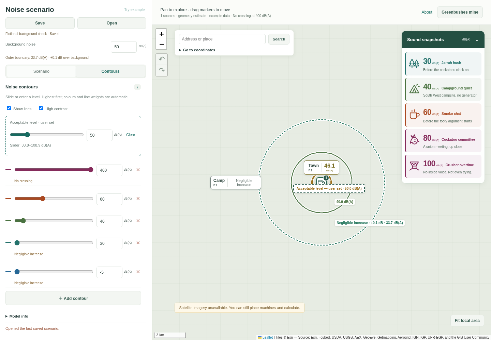
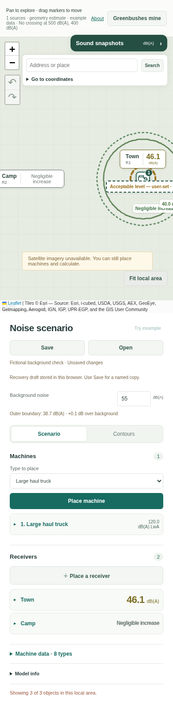

# 024 — Replace distance-only scope with a defensible POC policy

Status: Implemented; ready for review.
Task creation explicitly requested by the owner on 17 November 2026.

## Problem and scope

The owner rejects a blanket 10 km audibility cutoff for receivers and contour lines. Review how to expose reasonable results while preventing distant geometry-only predictions being presented as credible hearing estimates. Separate computational safety, source/model plausibility and output confidence. Present the smallest defensible policy with its assumptions and test cases, then agree it with the owner before coding a new rule.

## Exclusions

No new framework, service, unapproved propagation engine or full assessment platform. These
briefs authorise planning of the requested POC features, not implementation within the
documentation PR. Keep future implementation in separate focused PRs.

## Acceptance

- [x] A policy comparison covers an ordinary haul truck at about 300 km, a plausible louder-source/local case beyond 10 km, the same source at several distances, combined sources and contour failures. Distance alone cannot decide whether sound can be heard.
- [x] Extreme 300 dB(A) LwA examples are flagged as outside the ordinary machinery/linear point-source model rather than treated as validated explosions. No invented absorption, background level, legal limit or arbitrary audibility threshold is introduced.
- [x] The agreed policy specifies numeric/warning/withheld states consistently for receivers and lines, retaining independent contour errors, all-source combination and real compute limits. It does not alter the separate 10 km pairwise navigation-cluster rule.

## Verification

First reproduce current outputs with analytical references and document where the model cannot answer audibility. Use traceable sources for any proposed physics; new libraries or propagation engines require owner approval. After a policy is agreed, write small implementation/validation slices. Do not merely remove all guards or replace 10 km with another arbitrary distance.

## Likely files

- `docs/model.md`
- `src/scope.py (review)`
- `src/contours.py (review)`
- `tests/test_scope.py (review)`
- `docs/tasks/024-source-aware-model-scope.md`

Record the chosen scope, commit, actual checks and remaining limits here when work proceeds.

## Investigation — 18 November 2026

Read the [policy review](../scope-policy-review.md) for reproduced examples, alternatives,
proposed receiver/line/slider states, validation cases and a flow diagram. Investigation commit:
`2161e84`. Baseline main: `29ae47f` (task 030 merged). No application behaviour or dependencies changed.

The current guard hides a 130 dB(A) source at 10,001 m despite a change of less than
0.001 dB from 10,000 m, while permitting 300 dB(A) source contours inside 10 km. Removing
only the contour guard would leave the slider's distance-derived lower bound unchanged.
The review recommends qualified geometry estimates without hard distance suppression,
retained compute guards and a separate unsupported-input treatment for the 300 dB(A) stress
case. It does not propose a new audibility threshold or a general validated source-power cap.

At this investigation checkpoint, two choices remained: how to show distant geometry
arithmetic and whether to withhold extreme inputs. The approved adaptive background slice
below records the subsequent owner decision. No separate follow-up task was added.

Evidence: independent intensity-reference calculations matched `source_level` in 21 cases;
real baseline calls reproduced the distance discontinuity, mixed-source totals, per-level
scope/domain failures and the slider bounds. OSHA's free-field and power/pressure guidance
was read; unavailable NPL/WA references are documented in the review and not relied upon.
`uv run pytest tests/test_scope.py tests/test_contour_range.py tests/test_contours.py -q`:
**35 passed**. Documentation links and whitespace checks passed. No UI change was made,
so no new screenshots were needed. See the review for reproducible commands and limits.

## Approved adaptive background slice — 18 November 2026

The owner clarified that no fixed receiver-distance or numeric contour-level cap is wanted.
They approved one scenario-wide background level and an adaptive outer contour at a **0.1 dB
increase**, with **Negligible increase** beyond it. This supersedes the earlier pending
geometry-only proposal and the suggested withholding of 300 dB stress inputs. Extreme powers
remain experimental arithmetic with a warning; no new propagation correction is introduced.

Implementation contract:

- Background is nullable and finite, defaults to unset for new/legacy scenes, and is retained
  by Save/Open and draft recovery. Zero is a real level. The app invents no background value.
- All machinery energies combine before comparison. The threshold is background minus
  approximately 16.327747 dB; an automatic dotted contour marks that exact machinery level.
  Numeric receiver values still show machinery alone. Below the threshold, receiver totals
  and contribution numbers are replaced by the negligible label; lower contours retain their
  settings/status but are not drawn. The acceptable line uses the same rule.
- Receiver distance suppression and the fixed 200 km contour domain cap are removed. Finite
  numeric contour/reference values have no 0–300 cap. Machine emission inputs retain their
  existing 0–300 range. Unsupported projection domains and the 640,000-cell budget remain
  explicit, isolated failures; this is not a promise of unlimited computation or physical validity.
- Existing 25 editable unique levels remain a work budget; API requests allow one additional
  derived boundary. The independent 10 km pairwise navigation rule is unchanged.
- Background changes refresh receiver/geometry/range lanes. Cache signatures include background;
  classification cannot be reused across backgrounds. Camera/style/name-only edits stay local.

### Verification

- **145 pytest tests passed**, including independent energy-ratio checks, all-source totals,
  negative/background-extreme finite inputs, 300 km receivers, a real 282 km contour,
  independent projection failures, no-source/near-field states, saved-background round-trips
  and rejection of non-finite/non-numeric values.
- Ruff check/format, Pyright (zero errors) and all 25 installed skills' integrity passed.
- Browser fixtures: background-boundary **15**, receiver-map-names **17**, map-deletion **21**,
  repeat-placement **14**, placement-history **23**, acceptable-label-priority **10**,
  contour-cache **16** checks passed (116 total), with no page errors.
- Full-app fictional scene: dotted boundary and negligible receiver/ordinary-level statuses;
  changing background reveals previously suppressed results; negative and 500 dB contour entry;
  clearing background; exact source/receiver preservation through Save/Open; restored background
  and labels after reload/recovery. No prediction/contour/range calls from contrast, visibility
  or camera-only actions. Desktop and 390 px checks passed without horizontal page overflow.
- Inspected desktop and narrow screenshots. Reduced negligible sidebar text and corrected compact
  number-field widths after inspecting the first captures. Screenshot evidence is below.

| Desktop contour editor and adaptive boundary | Narrow layout and receiver status |
| --- | --- |
|  |  |

Satellite imagery was unavailable in this workspace; screenshots use the existing grid fallback.
Narrow-screen map labels can overlap or extend past map edges; the desktop workflow is the
primary target. Background is spatially uniform and not a masking/terrain/weather model.
A negligible increase is not proof of inaudibility. No new third-party technology was added.
Author reviewed the diff and screenshots; no independent reviewer was used. Owner review and
merge remain required. Implementation: `dffef64` (runtime, tests and browser fixture), followed by a wording
correction to the slider-unavailable message; it avoids claiming that sampled source peaks
prove the entire field negligible.
