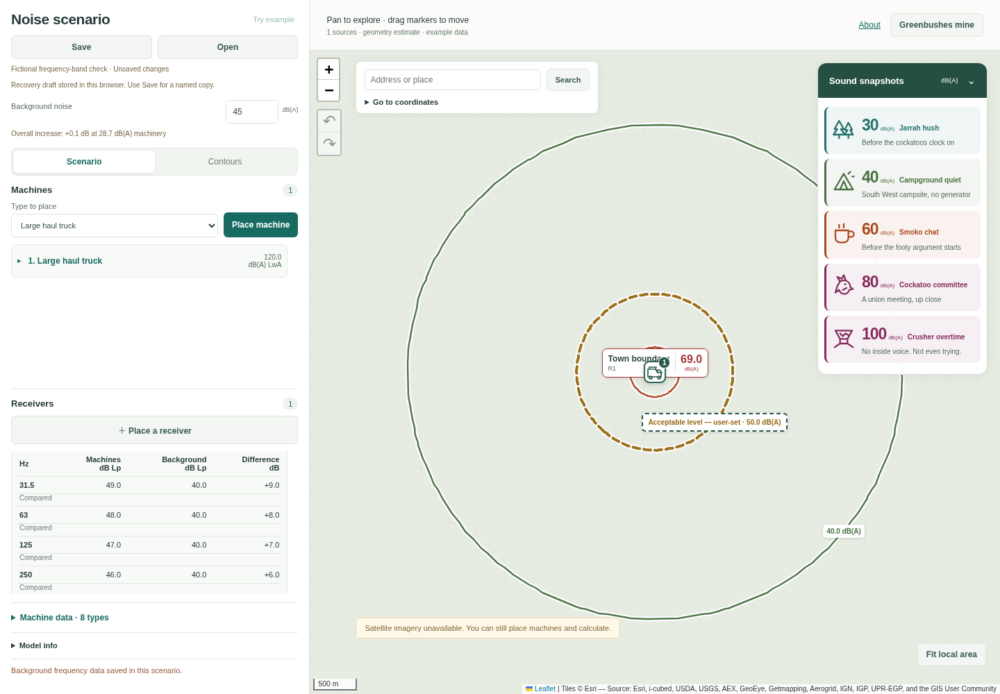

# 026 — Select feasible improvements to the POC sound model

Status: Approved band foundation implemented; backend and editor PRs ready for review.
Requested by the owner on 17 November 2026, alongside reducing developer-facing UI copy.
Related: 024 (credible display scope), parked themes 002–005 (evidence and validation).

## Scope

Identify which missing effects can be added credibly with the data and existing Python stack.
Compare required inputs, physical method, validation reference, effort, licensing/dependencies
and expected benefit. Recommend one small first increment, not a full environmental engine.

Consider source/receiver heights and 3D paths; measured source powers and frequency spectra;
frequency-dependent atmospheric absorption; directivity and reflective ground; pits/terrain,
buildings, barriers and diffraction; weather refraction; operating cycles; background noise
comparison; and uncertainty. Mark options blocked by absent evidence or an unsuitable model.

A-weighted broadband inputs alone do not justify choosing a representative frequency or
inventing a universal absorption coefficient. Cloud cover is not a substitute for wind,
temperature or humidity data. Background noise must be a separate measured/assumed input,
not a number inferred from the humorous guide. Do not silently convert averages into maxima.

## Exclusions

No automatic installation of an engine or GIS/weather service, invented site data, arbitrary
attenuation credits, legal pass/fail criteria, or claim of environmental validation. Keep
projected implementation small and preserve the current model as an explicit baseline.

## Acceptance

- [x] A short option matrix states required data, method, limits, reference evidence and effort for each effect, distinguishing feasible POC slices from parked work.
- [x] One recommended increment has a clear input/output contract and independent analytical/reference validation cases, including an omitted-effect baseline and representative failure/boundary cases.
- [x] The owner agrees which slice proceeds before it is implemented; any new library, dataset or service receives separate approval. Scope 024 remains a display-confidence decision, not a replacement for missing physics.

## Verification

Check authoritative method documentation against the proposed input quantities and units.
Cite sources actually read and flag unavailable references. If a tiny experiment is needed,
use fictional inputs and existing dependencies, report its limitations and do not integrate it
into app predictions as a side effect. Propose the smallest implementation task(s) only after
the selected approach and validation basis are clear.

## Likely files

- `docs/model.md`
- `docs/library-options.md`
- `docs/tasks/026-feasible-propagation-effects.md`
- The selected calculation modules/tests for read-only investigation

## Review — 19 November 2026

See [model feasibility](../model-feasibility.md) for the option matrix, data/method/dependency
requirements, references actually read, a small numerical example, the proposed input/output
contract, independent validation cases and a path-to-audibility diagram.

The owner asked to follow the recommendation and then work on this task. The immediate
recommendation is implemented separately: the existing 0.1 dB boundary now says **Negligible
overall increase**, without changing its calculation or inventing a maximum hearing distance.
This review is the subsequent task, not an implementation of an environmental engine.

Recommended next increment: optional measured/assumed octave-band equipment power and
background pressure evidence, plus receiver-only geometry band calculations. Keep existing
LwA results/contours untouched; do not fabricate spectra, apply unverified A-weighting
coefficients, or claim the band comparison establishes audibility. No measured spectral data
were found in the repository. The owner has not yet selected this concrete slice; acceptance
item 3 remains open. No new implementation brief, dependency, GIS/weather service or detection
method has been added.

Evidence read: OSHA frequency/weighting, sound-power/pressure and free-field guidance, plus
FHWA measurement/meteorology/absorption and ground/barrier context. ISO/NPL requests were
unavailable and are explicitly excluded as read evidence. These are not WA assessment or
mine-audibility validation claims.

A fictional two-bin calculation reproduced identical overall backgrounds (45.000434 dB(A))
and increases (0.107732 dB), despite active-bin margins of +24 versus −16 dB. Independent
intensity arithmetic reproduced 49.007901 dB at 100 m for 100 dB sound power, −6.020600 dB
on doubling distance and +3.010300 dB for equal-source energy addition. These are foundation
checks, not a validated masking model. Existing prediction code was unchanged by the review.
86 local documentation links resolve; `git diff --check` passed. Author review only;
implementation selection and any method/technology approval remain with the owner.

## Owner selection and implementation — 19 November 2026

The owner explicitly selected **Proceed with the frequency-band foundation**: optional
machine sound-power bands, background pressure bands and receiver comparisons, with existing
contours unchanged. No new technology was needed. Printing was separately removed from the POC.

The [band contract](../frequency-band-contract.md) defines the fixed unweighted grid,
measurement quantities, unknown values, averaging basis, signed comparisons and unchanged
legacy path. The backend and persistence slice is separated from its optional browser editor.
The review's earlier pending-selection statements above are historical, superseded by this
record; no measured spectra or validated audibility method have been acquired.

Backend evidence: 160 pytest tests passed, including independent 100 m/doubled-distance and
equal-source energy references, all-source completeness, temporal compatibility, finite-input
validation, save round-trips and unchanged overall receiver/contour outputs. Ruff and Pyright
passed. Reference metadata is user evidence, not certification. No independent reviewer.

## Editor and integrated verification

Machine data and Model info now contain optional unweighted band editors; receiver details
contain a neutral frequency-comparison table. All profiles start blank, retain partial data
and evidence references, and are restored by Save/Open/recovery. Overall LwA/background,
contours and the negligible-overall-increase boundary are unchanged. No audibility model,
spectral contour, environmental correction, dependency or measured dataset was added.

Verification: **160 Python tests passed**; Ruff check/format, Pyright and 25-skill integrity
passed. Browser fixtures passed **154 checks** (frequency 14, equipment metadata 6, sidebar
15, background 15, receiver names 17, deletion 21, repeat placement 14, history 23, foreground
label 13, contour cache 16). The sidebar fixture's obsolete distance-scope expectation was
updated to the current negligible-overall-increase status.

Full-app fictional workflow verified blank initial fields, source/background input, independent
unweighted results and unchanged overall reading, missing-band and mismatched-duration states,
matching-duration restoration, exact evidence Save/Open/recovery, literal markup references,
receiver-only request counts and no acoustic requests on camera movement. An unrelated source
editor draft survives background updates; open comparison details survive pending responses.
Source and background spectral edits requested only `/api/predict`, with no contour/range work.

Desktop source/background editor, scrolled receiver table and 390 px screenshots were captured
and inspected. Advanced disclosures scroll within the existing panels; no horizontal page
overflow. Satellite imagery was unavailable, so captures use the existing grid fallback.

[Source editor](../images/frequency-source-editor.png) ·
[Background editor](../images/frequency-background-editor.png) ·
[Narrow layout](../images/frequency-bands-mobile.png)

Backend implementation: `f4bf8f8`. Editor implementation: `9a391ff`. Documentation links: 118 local targets resolve;
`git diff --check` passed. Screenshot spectra are fictional, deliberately independent of
the overall power input, and are not a verified equipment dataset.
Author review only; no independent reviewer or site/acoustic validation. Matching averaging
periods do not certify representative measurements, and octave bands alone cannot establish
narrow-tone detection. The proposed physical propagation/detection methods remain unimplemented.
