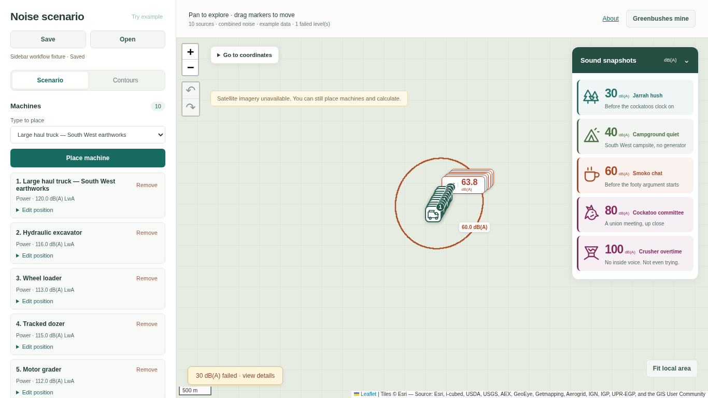
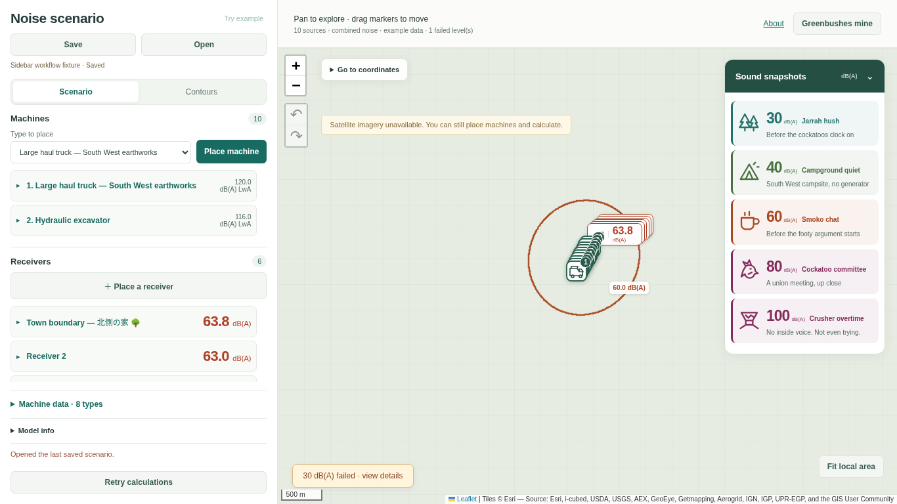

# 027 — Make the desktop sidebar faster to use

Status: Implemented; ready for review.
Requested by the owner on 17 November 2026. Related: 011 (simple workflow).

## Problem and baseline

The sidebar is too narrow and becomes a long stack of cards. Frequent actions require
scrolling past unrelated objects, slowing down scenario editing even when calculations
are fast. Current desktop widths are approximately 310–350 px; Scenario/Contours tabs,
receiver details, equipment notes and Save/Open already exist.

## Scope

Rework the existing sidebar for desktop use: give controls and names enough horizontal
room while retaining a useful map, reduce vertical repetition, and keep common actions
close at hand. Use compact object summaries with details revealed when needed, rather
than expanding every machine/receiver into a tall card. Keep placement, receiver readings,
contour editing and saving easy to find. Choose the simplest layout that meets these goals;
do not add controls just to make the panel look redesigned.

First capture the current workflow using a fictional scene with 10 machines, six receivers
and the default contours. Record scrolls and clicks for placing another machine, finding
a receiver reading, editing its name/position, changing a contour and saving. Implement a
small improvement, then repeat the same workflow to demonstrate the benefit. Preserve all
existing capabilities and pending/error feedback, including individual contour failures.

## Exclusions

No new application framework, dependency, feature suite, map redesign, physics change,
saved-data change or acoustic optimisation. Do not solve density by shrinking text or
hiding failures. A sidebar layout change must not start sound requests by itself.

## Acceptance

- [x] At 1366×768 and 1920×1080, common placement, Save/Open and Scenario/Contours navigation remain reachable without scrolling through object cards; wider content remains readable while the map retains at least half the desktop viewport width.
- [x] The same 10-machine/six-receiver workflow requires fewer scroll movements than the baseline without increasing its total clicks. Long names and source notes wrap, receiver values stay easy to scan, and detailed editing remains available without expanding every object.
- [x] Keyboard focus and unsaved editing survive navigation; Save/Open, recovery and error states still work. Layout/tab/detail-only interactions send no acoustic requests, inputs/results are preserved, and a 390 px layout has no horizontal overflow.

## Verification

Capture and inspect before/after desktop screenshots with a receiver editor open, plus
pending/failed-contour feedback and the narrow layout. Record the workflow counts and
viewport sizes, check keyboard editing and long Unicode labels, and count prediction/contour
requests during presentation-only changes. Use existing repository checks and available
browser tools; no new testing dependency is approved. Report unverified behaviours honestly.

## Likely implementation files

- `src/static/css/sidebar-simple.css` and the affected responsive/layout rules
- `src/static/js/ui-entities.js`
- `src/static/js/sidebar.js`
- The affected sidebar HTML partials

Start from current `main` when implementing; preserve the local-fit action if merged.
Keep the first pass around five implementation files. If it grows beyond that, split the
work before editing. Announce task 027 by number and title before starting implementation.
Record the implementation commit, checks, workflow counts and screenshots here when complete.

## Implementation and evidence — 18 November 2026

The desktop sidebar is 380–480 px wide. Save/Open and workspace tabs stay above compact
rows; machine and receiver lists scroll separately below their placement controls. Expanding
an object exposes its editor and removal action. Readings/pending/failure status remain in
the row summary; near/distant-source flags stay visible. Machine contributions are separately
collapsible. Advanced Machine data/Model info panels share space without replacing drafts.
Mobile keeps ordinary page scrolling. No new dependency, saved-data or calculation change.

The same fictional scene starts with 10 machines, six receivers and default contours. The
workflow places an 11th machine, locates receiver 6, names/moves it, changes 60 to 61 dB,
and saves. Scroll gestures use the same target-directed wheel helper capped at 520 px in
both versions; clicks include field focus and the map placement. These are repeatable task
measurements, not a claim about every user's scroll preferences.

| Viewport | Before scroll gestures | After scroll gestures | Clicks before → after |
| --- | --- | --- | --- |
| 1366 × 768 | 8 | 4 | 9 → 9 |
| 1920 × 1080 | 6 | 1 | 9 → 9 |

Before (machines push receivers and header controls off-screen):

After (both object groups and common actions remain accessible):

Actual Chromium checks cover saved inputs, Save/Open, recovery, keyboard tab focus,
coordinate/contour drafts across tabs, long Unicode names, advanced settings, 390/768/1024
px layouts and zero prediction/contour/range calls on presentation-only actions. Desktop
map width remains above half the viewport. Receiver pending and controlled HTTP 503 states,
individual contour failures, open editors and the narrow layout were captured and inspected.

`tests/browser/sidebar-entities.html` adds 15 checks for compact summaries, text escaping,
drafts, disclosure events, flags, open receiver state, removal controls and keyboard tabs.
The full Python suite passes 110 tests; Ruff, formatting, Pyright, skill integrity and diff
checks pass. Reproduction artifacts: `/workspace/artifacts/check_sidebar_workflow.py`,
`check_sidebar_states.py` and `sidebar-*.png`. Before comparison used main commit `eb8ef3e`.
Satellite imagery was unavailable during capture. The existing 30 dB extraction guard still
reported a failed level for the fixture; other levels and its failure alert remained visible.
Screen-reader speech and a Windows browser were not manually tested. No merge is performed.

Implementation commit: `cb198e0`. Documentation and screenshot evidence follow separately.

Review stack: this branch includes task 023 (#32); the sidebar PR targets
`agent/control-repeat-placement`. Merge #32 first, then retarget this PR to main.
