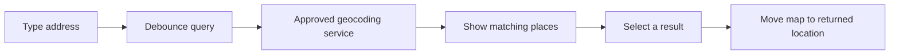

# 028 — Find an address with autocomplete

Status: Ready for provider review; approve the service before integration.
Requested by the owner on 17 November 2026. Related: 015 (local navigation), 027 (sidebar).

## Problem and baseline

Navigating somewhere new requires knowing its coordinates. Let users type an address or
place, choose a suggestion and move the map there. Keep the existing coordinate entry,
Greenbushes and local-fit actions available without cluttering the sidebar.

## Scope

Use a geocoding service that returns coordinates and readable address suggestions. Prefer
one compact search field in the map navigation controls. Selecting a result moves the camera
to its returned bounds, or its coordinates with a suitable zoom when bounds are absent.
Typing alone does not move the map. Show enough location context (town/state/postcode where
available) to distinguish similar addresses. Support places beyond Greenbushes.

Before integration, compare free services for Australian address coverage, explicit permission
for autocomplete, usage limits, attribution, privacy, and key/account requirements. Explain
what typed queries leave the app and obtain the owner's approval of the selected service.
A free forward-geocoding endpoint is not automatically permitted for autocomplete. Do not
choose a paid service or add a dependency by implication. Use existing vanilla JavaScript
and FastAPI; add a backend proxy only if the provider requires it. Never commit credentials
or expose a secret key in browser code. Keep provider access separate from the map renderer.

Debounce queries, respect the approved provider's minimum query length/rate policy and
ignore stale responses. Provide keyboard-accessible suggestions (Up/Down, Enter, Escape),
visible focus and concise loading, no-results and network-error states. Use returned
coordinates, with validation; never guess or silently clamp a result's location.

Search and selection change the camera only: do not create/move objects or request acoustic
predictions or contour ranges. Retain existing Save/recovery behaviour for camera changes.

## Exclusions

No routes, directions, reverse geocoding, address database, map-provider replacement or
changes to the sound model. No automatic selection of the first result and no new task
ideas beyond this lookup workflow. This brief does not implement or approve a service.

## Acceptance

- [ ] With the approved provider, typing a query shows distinguishable suggestions; clicking or keyboard-selecting one moves the map to its returned location. Coordinate navigation remains available and the controls fit the desktop layout without horizontal overflow at 390 px.
- [ ] Delayed/out-of-order responses cannot replace newer results. Loading, empty, failed and invalid-coordinate responses have clear states; keyboard focus and Escape dismissal work. Requests respect provider terms and required attribution is shown.
- [ ] Search/navigation causes zero prediction, contour or contour-range requests and preserves all machines, receivers and inputs. Existing explicit Save/Open and recovery semantics remain intact; provider approval and applicable terms are recorded.

## Verification

Use mocked provider fixtures for two similar addresses, bounds/no-bounds results, Unicode,
no results, failures, invalid coordinates and reversed response order. Exercise typing,
keyboard selection and mouse selection; assert the actual map centre/bounds and count
acoustic requests. Inspect desktop screenshots with suggestions and an error open, plus a
narrow viewport. After provider approval, try a Greenbushes-area address and another town
against the live service; report any network or coverage limits honestly. Run the existing
checks appropriate to the eventual implementation; no new testing dependency is authorised.

## Likely implementation files and handoff

Start from then-current main. Read `src/static/js/map-manager.js` and the existing navigation
markup before deciding placement. Keep provider requests in a small address-search module;
change the navigation markup/styles and, only if required, a FastAPI route. Aim for about
five implementation files and split the work if it grows. Record the approved provider,
implementation commit, checks and inspected screenshots here. Announce task 028 by number
and title before implementing it.
