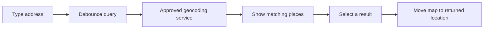
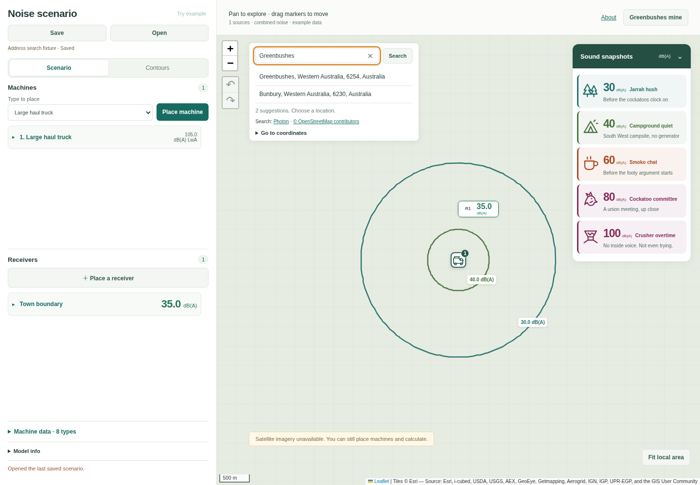

# 028 — Find an address with autocomplete

Status: Implemented and verified; ready for review.
Requested by the owner on 17 November 2026. Related: 015 (local navigation), 027 (sidebar).

## Problem and baseline

Navigating somewhere new requires knowing its coordinates. Let users type an address or
place, choose a suggestion and move the map there. Keep the existing coordinate entry,
Greenbushes and local-fit actions available without cluttering the sidebar.

## Scope

Use a geocoding service that returns coordinates and readable address suggestions. Prefer
one compact search field in the map navigation controls. Selecting a result moves the camera
to its returned bounds, or its coordinates with a suitable zoom when bounds are absent.
Typing alone does not move the map. Show enough location context (town/state/postcode where
available) to distinguish similar addresses. Support places beyond Greenbushes.

Before integration, compare free services for Australian address coverage, explicit permission
for autocomplete, usage limits, attribution, privacy, and key/account requirements. Explain
what typed queries leave the app and obtain the owner's approval of the selected service.
A free forward-geocoding endpoint is not automatically permitted for autocomplete. Do not
choose a paid service or add a dependency by implication. Use existing vanilla JavaScript
and FastAPI; add a backend adapter only where credentials or provider usage controls justify it. Never commit credentials
or expose a secret key in browser code. Keep provider access separate from the map renderer.

Debounce queries, respect the approved provider's minimum query length/rate policy and
ignore stale responses. Provide keyboard-accessible suggestions (Up/Down, Enter, Escape),
visible focus and concise loading, no-results and network-error states. Use returned
coordinates, with validation; never guess or silently clamp a result's location.

Search and selection change the camera only: do not create/move objects or request acoustic
predictions or contour ranges. Retain existing Save/recovery behaviour for camera changes.

## Exclusions

No routes, directions, reverse geocoding, address database, map-provider replacement or
changes to the sound model. No automatic selection of the first result and no new task
ideas beyond this lookup workflow. This brief does not implement or approve a service.

## Acceptance

- [x] With the approved provider, typing a query shows distinguishable suggestions; clicking or keyboard-selecting one moves the map to its returned location. Coordinate navigation remains available and the controls fit the desktop layout without horizontal overflow at 390 px.
- [x] Delayed/out-of-order responses cannot replace newer results. Loading, empty, failed and invalid-coordinate responses have clear states; keyboard focus and Escape dismissal work. Requests respect provider terms and required attribution is shown.
- [x] Search/navigation causes zero prediction, contour or contour-range requests and preserves all machines, receivers and inputs. Existing explicit Save/Open and recovery semantics remain intact; provider approval and applicable terms are recorded.

## Verification

Use mocked provider fixtures for two similar addresses, bounds/no-bounds results, Unicode,
no results, failures, invalid coordinates and reversed response order. Exercise typing,
keyboard selection and mouse selection; assert the actual map centre/bounds and count
acoustic requests. Inspect desktop screenshots with suggestions and an error open, plus a
narrow viewport. After provider approval, try a Greenbushes-area address and another town
against the live service; report any network or coverage limits honestly. Run the existing
checks appropriate to the eventual implementation; no new testing dependency is authorised.

## Likely implementation files and handoff

Start from then-current main. Read `src/static/js/map-manager.js` and the existing navigation
markup before deciding placement. Keep provider requests in a small address-search module;
change the navigation markup/styles and, only if required, a FastAPI route. Aim for about
five implementation files and split the work if it grows. Record the approved provider,
implementation commit, checks and inspected screenshots here. Announce task 028 by number
and title before implementing it.

## Provider-review handoff — 18 November 2026

See the [provider comparison and proposed integration](028-address-provider-review.md).
Photon is recommended for the POC; three small live place/street probes succeeded.
Owner approved Photon on 18 November 2026. The standard-library API adapter is implemented;
browser acceptance is recorded below. No new dependency is added. The backend adapter
coordinates fair use across browser tabs; CORS itself does not require a proxy.

### API adapter verification

`POST /api/geocode` and its standard-library adapter pass 20 focused checks for parsing,
coordinate/bounds validation, invalid input, duplicate/result limits, cache expiry/eviction,
concurrency, cooldown and sanitized HTTP errors. Full suite: 130 passing tests; Ruff, format,
Pyright and skill integrity pass. Live local-API probes returned Greenbushes and Bunbury
with correct latitude/longitude conversion and optional bounds. No private scenario data
was sent. Browser implementation and end-to-end acceptance are in the next stacked PR.

### Browser integration and acceptance — 18 November 2026

Address/place search now shares a compact panel with the existing coordinate entry. Typing
waits for a pause, requests only the local adapter, and never navigates automatically.
Mouse selection or Arrow Up/Down and Enter fits validated bounds or centres the returned
point. Escape/dismissal cancels pending work. Retry is explicit; provider cooldown is
respected. Attribution remains near results and selected labels; About explains query data.

`tests/browser/address-search.html` passes 19 checks, including literal text, numeric/bounds
validation, debouncing, no automatic selection, keyboard activation, stale responses even
when abort is ignored, attribution, clearing and dismissal. Actual Chromium checks pass:

- Keyboard and mouse selection with saved camera coordinates/bounds read back from the API.
- Preserved machine, receiver, catalogue, level and cloud inputs; zero prediction, contour
  or contour-range calls during typing, result selection, dismissal and coordinate navigation.
- Out-of-order responses, empty/invalid locations, offline, HTTP 503/429 and explicit retry;
  no automatic request loop after an error. Save/Open camera state and browser recovery work.
- 1440 px desktop and 390 px layout screenshots inspected with suggestions and errors open;
  no horizontal page overflow.

Live browser searches selected Greenbushes and Bunbury successfully through the approved
backend adapter. These public place probes do not validate exhaustive address coverage.
Satellite imagery was unavailable during capture; the grid and tile warning remained usable.
Windows and screen-reader speech have not been manually tested.

Full suite: 130 pytest tests; Ruff, formatting, Pyright, skill integrity and diff checks pass.
The API slice is commit `b2c2093` in #40, based on provider review #36. The browser PR stacks
on `agent/address-search-api`; review/merge #36, then #40, then the browser PR, retargeting
each dependent PR after its base lands. No merge or deployment is performed.

Reproduction artifacts: `/workspace/artifacts/check_address_search.py`,
`check_address_live.py`, `address-search-*.png` and `address-live-*.png`. The checked-in
example below uses a fictional machine/receiver scene and controlled suggestion fixtures.

Browser implementation commit: `5d917c9`. Documentation evidence follows separately.

### Follow-up: clear address and refresh PR stack

The address input now has a compact × labelled Clear address. It appears while text is
present, clears input/results/status, cancels queued/in-flight work and focuses the input.
It does not move the camera, alter saved inputs or send acoustic requests. Late responses
cannot reopen the cleared list. Keyboard activation works at the narrow layout too.

The browser page now passes 19 checks. Actual full-app checks pass pointer/keyboard clear,
unchanged saved status/camera, no acoustic requests, existing search selection, coordinate
entry and recovery. Desktop, 390 px and cleared-input focus screenshots were inspected:
`/workspace/artifacts/address-clear-*.png`, `address-cleared.png` and `check_address_clear.py`.
All 130 pytest tests and Ruff/format/Pyright/skill checks pass.

PR #36 was updated from main, preserving the newer 029/030 task briefs and the existing
VS Code settings commit on its branch. The resolution is propagated through #40 and #42
without rewriting their history. Review order remains #36 → #40 → #42; no PR is merged.
