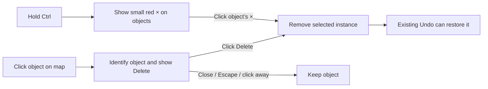

# 029 — Delete map objects with a popup or Ctrl shortcut

Status: Ready for implementation when selected.
Requested by the owner on 18 November 2026. Related: 018 (undo/redo), 027 (sidebar).

## Problem and baseline

Removing an object currently requires finding its sidebar entry. Machines already open a
map popup with their sound power and evidence note; receivers have map readings and hover
labels. Let users remove either kind directly on the map in two deliberate clicks, or
with one click on a small red × while holding Control.

## Scope

### Normal interaction: two clicks

1. Click a machine icon or receiver marker to open its object popup. Identify the selected
   object clearly and show a **Delete machine** or **Delete receiver** button. This first
   click never deletes anything.
2. Click that Delete button to remove only the selected instance and close its popup.
   Do not add a third confirmation dialog or a separate delete mode.

### Hold Ctrl: show a one-click delete control

While Control is held, show a small red **×** beside each visible machine and receiver
marker. Clicking that object's × immediately deletes just that instance: no popup or extra
confirmation is required. Give the control an accessible name identifying its target (for
example, **Delete machine 3** or **Delete Town boundary**) and an adequate hit area while
keeping the visual small. Its position must make the associated object unambiguous.

Holding Ctrl alone and Ctrl-clicking the ordinary marker never delete. Only activation of
the × invokes this shortcut. Releasing Control hides the controls; window blur, switching
away from the tab, or Escape also clears them so a missed keyup cannot leave them stuck.
Do not interfere with Control shortcuts while typing in fields or using dialogs.

Keep the existing Ctrl-click repeat placement on empty map space. A × click must not bubble
into placement, add a machine, open a popup or start marker dragging. Removing a marker
must not let its replacement or an underlying object receive a second accidental click.
The two-click popup path remains available without Control, including on touch devices.

Keep existing machine information and receiver readings available. Opening another object's
popup selects that object instead; closing the popup, clicking away or pressing Escape
cancels without deleting. Hover and dragging never delete. Selection and popup controls must
not bubble into map placement or create another object, including during Ctrl-repeat mode.

Use existing `removeSource`/`removeReceiver` methods so deletion remains one undoable action,
marks the scenario dirty and participates in recovery. Undo restores the exact object ID,
coordinates, optional name and ordering; redo removes it again. Delete an instance, never its
machine type or a saved scenario. Keep sidebar removal available.

## Exclusions and dependencies

No bulk deletion, keyboard Delete shortcut, right-click menu, new service/dependency, saved
schema change or calculation change. Reuse the current Leaflet popups and placement history.
This brief adds a task, not its implementation. Start from the then-current main and announce
task 029 by number and title before implementing it.

## Acceptance

- [ ] Without Control, exactly two clicks delete either object: marker, then labelled Delete. Holding Control shows a small red × for each visible object; one click on its × deletes only that object. Releasing Control, Escape, window blur and tab switching clear the shortcut controls. Holding Control alone, ordinary marker selection, hovering, dragging and cancellation never delete.
- [ ] Only the chosen instance disappears from map/sidebar and inputs; its type and other objects stay intact. Undo/redo preserves identity, coordinates, names and order. Save/Open and recovery retain the accepted deletion; an already-removed object's stale control is a harmless no-op. Both deletion paths behave the same way and cannot add an object or trigger underlying markers during ordinary/Ctrl-repeat placement.
- [ ] Showing/hiding × controls and opening/closing popups make no acoustic requests. Source removal uses the existing source recalculation path; receiver removal updates receivers without recalculating contours. Delete controls work with keyboard activation, have visible focus and clear object identity, and remain usable at desktop and 390 px widths.

## Verification and likely files

Use a fictional scene with several machines of the same type and named receivers. Count
actual clicks for popup and Ctrl-× deletion on both object types; verify exact retained/removed IDs, undo/redo, save
and recovery. Count prediction/contour/range requests around selection, cancellation and
each deletion. Exercise Control press/release, missed keyup after blur/tab switching, Escape,
text-field shortcuts, dragging, adjacent/overlapping markers, active repeat placement, keyboard
activation and stale controls. Capture and inspect popups, the Ctrl-held × state and the
resulting map. Check that each × stays associated with its marker when panning or zooming.
Run existing checks appropriate to the implementation; add a focused regression using the
repository's browser tooling without introducing a dependency.

Likely files: `src/static/js/map-manager.js`, popup styles in `src/static/css/map.css`, and a
focused browser regression. Read the existing store/history and request subscriptions before
editing; change those only if required to preserve their contracts. Keep the implementation
small and record its commit, checks, screenshots and remaining limits here when complete.
