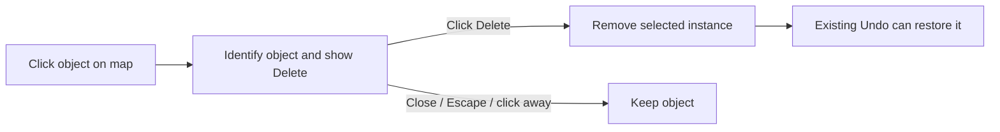

# 029 — Delete a machine or receiver from the map in two clicks

Status: Ready for implementation when selected.
Requested by the owner on 18 November 2026. Related: 018 (undo/redo), 027 (sidebar).

## Problem and baseline

Removing an object currently requires finding its sidebar entry. Machines already open a
map popup with their sound power and evidence note; receivers have map readings and hover
labels. Let users remove either kind directly on the map in two deliberate clicks.

## Scope

1. Click a machine icon or receiver marker to open its object popup. Identify the selected
   object clearly and show a **Delete machine** or **Delete receiver** button. This first
   click never deletes anything.
2. Click that Delete button to remove only the selected instance and close its popup.
   Do not add a third confirmation dialog or a separate delete mode.

Keep existing machine information and receiver readings available. Opening another object's
popup selects that object instead; closing the popup, clicking away or pressing Escape
cancels without deleting. Hover and dragging never delete. Selection and popup controls must
not bubble into map placement or create another object, including during Ctrl-repeat mode.

Use existing `removeSource`/`removeReceiver` methods so deletion remains one undoable action,
marks the scenario dirty and participates in recovery. Undo restores the exact object ID,
coordinates, optional name and ordering; redo removes it again. Delete an instance, never its
machine type or a saved scenario. Keep sidebar removal available.

## Exclusions and dependencies

No bulk deletion, keyboard Delete shortcut, right-click menu, new service/dependency, saved
schema change or calculation change. Reuse the current Leaflet popups and placement history.
This brief adds a task, not its implementation. Start from the then-current main and announce
task 029 by number and title before implementing it.

## Acceptance

- [ ] Starting with no popup open, exactly two clicks delete either a machine or a receiver: object, then its labelled Delete button. Selection, hover, drag, closing, Escape and clicking away never delete or create another object. Test during ordinary and Ctrl-repeat placement too.
- [ ] Only the chosen instance disappears from map/sidebar and inputs; its type and other objects stay intact. Undo/redo preserves identity, coordinates, names and order. Save/Open and recovery retain the accepted deletion; an already-removed object's stale control is a harmless no-op.
- [ ] Opening/closing popups makes no acoustic requests. Source removal uses the existing source recalculation path; receiver removal updates receivers without recalculating contours. Popup controls work with keyboard activation, have visible focus and clear object identity, and remain usable at desktop and 390 px widths.

## Verification and likely files

Use a fictional scene with several machines of the same type and named receivers. Count
actual clicks for both deletion paths; verify exact retained/removed IDs, undo/redo, save
and recovery. Count prediction/contour/range requests around selection, cancellation and
each deletion. Exercise dragging, adjacent/overlapping markers, active placement, keyboard
activation and stale controls. Capture and inspect both open popups and the resulting map.
Run existing checks appropriate to the implementation; add a focused regression using the
repository's browser tooling without introducing a dependency.

Likely files: `src/static/js/map-manager.js`, popup styles in `src/static/css/map.css`, and a
focused browser regression. Read the existing store/history and request subscriptions before
editing; change those only if required to preserve their contracts. Keep the implementation
small and record its commit, checks, screenshots and remaining limits here when complete.
