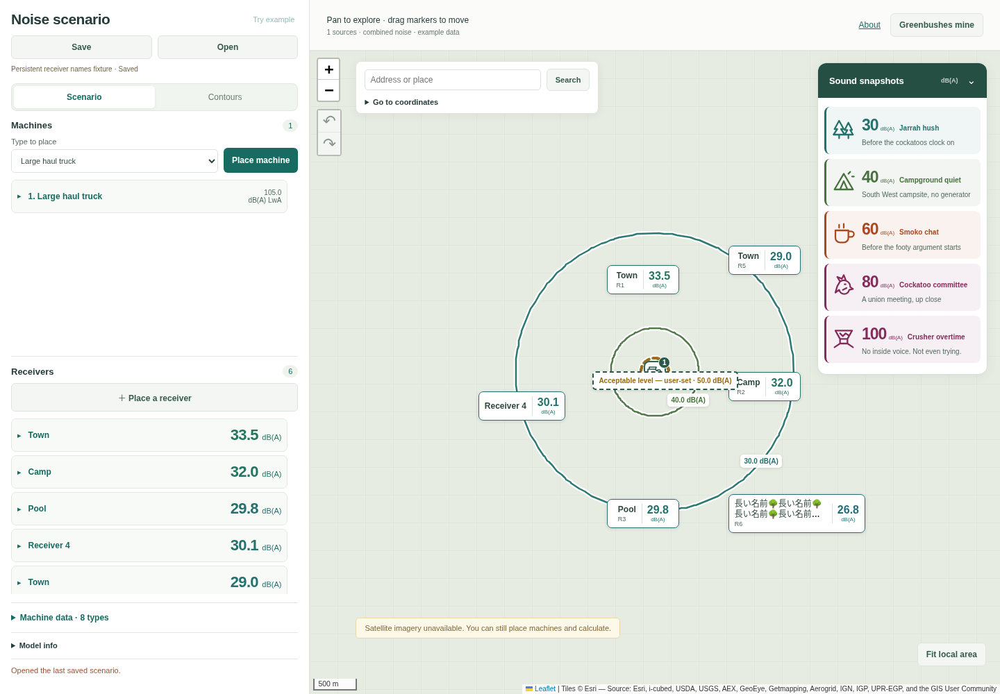
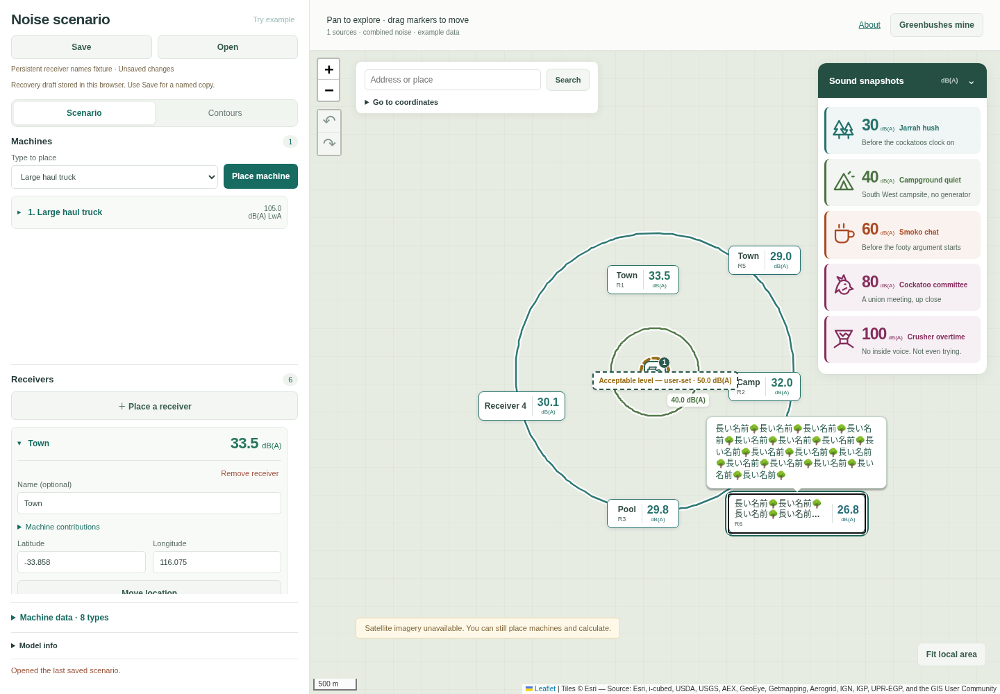
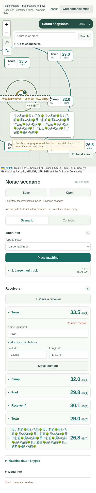

# 030 — Keep receiver names visible on the map

Status: Implemented; ready for review.
Requested by the owner on 18 November 2026. Related: 013–014 (receiver names), 027 (sidebar),
029 (map deletion controls).

## Problem and baseline

The sidebar persistently shows names such as Town, Camp and Pool. Map badges show only an
R-number and pressure reading, so matching a location to the sidebar still requires hover
or focus. Show each receiver's identity on the map alongside its current reading at all
times while its marker is visible.

## Scope

Use the existing optional receiver name as a persistent label in or attached to its map
badge, rather than opening a separate floating tooltip for every receiver. Unnamed receivers
use the existing **Receiver N** fallback. Retain a compact R-number reference where useful
for matching repeated names to their sidebar entries; do not introduce another name field.
Keep the coloured pressure reading and units easy to scan. Names remain visible for pending,
no-source, unavailable and outside-scope states too, without requiring selection or hover.

Update labels immediately when names are edited or cleared. Keep them attached to their
own receiver during dragging, panning, zooming, prediction refreshes, undo/redo and Save/Open
or recovery. Renaming must update text without interrupting an active drag or editor.

Keep the layout compact with a readable background over satellite imagery. Wrap ordinary
names; constrain unusually long names without letting them cover a large area. If a long
name is shortened visually, the full name must remain available through keyboard focus and
hover, and in the accessible description. Do not automatically hide ordinary names at
lower zoom levels. Avoid adding multiple label cards to one receiver or widening every badge
to the maximum possible name length.

Test nearby receivers and labels near map edges. Maintain clear attachment to the correct
marker and keep drag, popup and Ctrl-× hit areas usable when task 029 is present. Preserve
the acceptable-level label's established foreground priority and contour readability.
Do not solve overlap by silently hiding names; document any unavoidable overlap for
coincident receivers rather than adding a clustering system.

## Exclusions and dependencies

No new service/library, rename editor, saved schema, calculation change, receiver clustering
or label-settings panel. Reuse the receiver label helper and existing name notifications.
This brief adds a task, not its implementation. Start from then-current main; account for
task 029 if merged. Announce task 030 by number and title before implementing it.

## Acceptance

- [x] Named receivers visibly show their names and readings without hover/selection; unnamed ones show Receiver N. Names also remain visible with pending, empty, failed and outside-scope readings. Short names such as Town, Camp and Pool are fully readable; long Unicode and duplicate names remain identifiable without horizontal page overflow.
- [x] Rename/clear, drag, pan/zoom, reading updates, undo/redo, Save/Open and recovery keep each name paired with the correct receiver. Name updates preserve active editor/drag behaviour and cause zero prediction, contour or contour-range requests; camera-only changes remain free of acoustic requests too.
- [x] Desktop and 390 px screenshots show readable contrast and compact labels, including nearby receivers and map edges. Labels preserve drag/popup/deletion controls and acceptable-contour foreground priority; full names are available to keyboard users and accessible descriptions. No input data or physical/numerical result changes.

## Verification and likely files

Use a fictional Greenbushes-style scene with Town, Camp, Pool, an unnamed receiver, repeated
names and an 80-character Unicode name. Inspect the map with no hover open, then rename,
clear, drag and refresh readings. Count acoustic calls during naming and navigation; verify
stored names and restored identities after Save/Open and recovery. Exercise all reading
statuses, crowded markers, acceptable-line overlap, keyboard focus and task 029's controls
if available. Capture and inspect desktop/narrow screenshots with labels visible and a long
name focused. Run existing checks and add a focused browser regression without installing
a new dependency.

Likely files: `src/static/js/map-manager.js`, receiver-badge styles in
`src/static/css/contours.css`, and a browser regression. Read `receiverLabel` and the existing
`receiver-name` subscription before editing. Avoid marker replacement on a name-only update.
Record the implementation commit, checks, screenshots and remaining limits here when done.

## Implementation and evidence

Implementation: `8fd281955d8bed3598c9dc33a707dfa3972f2eeb` (18 November 2026).
Base: `main` at `e1abf6a`; task 029 was already merged. No dependency, schema, input or
calculation changes.

- `map-manager.js` renders names and readings in one badge. Named badges retain R-numbers;
  unnamed ones use Receiver N. Reading/name changes update existing nodes, preserving
  focus, editor selection and an active drag. Names are inserted as escaped/literal text.
- `contours.css` uses content-sized opaque badges, capped at 220 px wide and two name lines.
  Full names remain in hover/focus descriptions and accessible text. Measured bounds keep
  the badge centred at its coordinate and inform Leaflet's keyboard-focus pan behaviour.
- `map-object-controls.js` measures height as well as width to position Ctrl-delete controls
  beside taller badges. Existing popup, placement/history and foreground panes are retained.

### Verification

- New `tests/browser/receiver-map-names.html`: **17 checks passed**, including all reading
  states, literal/long Unicode names, focused-node preservation, anchoring and delete labels.
  The initial regression failed against the previous implementation, then passed with this change.
- Existing browser fixtures passed: map-deletion **21**, repeat-placement **14**,
  placement-history **23**, acceptable-label-priority **10**. No browser page errors.
- Full-app browser workflow used fictional Town, Camp, Pool, an unnamed receiver, duplicate
  Town labels and an 80-character Unicode name. Names/readings stayed paired through
  rename/clear, Save/Open, recovery, deletion, undo/redo, zoom and a real pointer drag.
  A delayed real prediction response during that drag preserved the marker node and ongoing
  pointer movement. Saving retained the moved receiver/name; Undo restored original coordinates.
- Renaming/clearing and camera-only navigation made **zero** predict/contours/contour-range
  requests. Renaming retained the focused editor and exact numeric readings. Save round-trips
  retained the original source/receiver payloads before a deliberate move.
- Full project checks: **130 pytest tests passed**; Ruff check, Ruff format, Pyright and
  the 25-skill integrity check passed. `git diff --check` passed.
- Inspected desktop, 390 px, long-name focus and Ctrl-delete screenshots. No horizontal page
  overflow. Acceptable-level labels retain foreground priority over receiver badges.

| At rest | Long name focused | Narrow layout |
| --- | --- | --- |
|  |  |  |

### Limits and review

Satellite imagery was unavailable in this workspace; screenshots show the existing grid
fallback. Opaque badge backgrounds and existing line contrast are retained, but live satellite
appearance was not verified here. Coincident or tightly packed badges can overlap; names
are not silently hidden and no clustering system was added. The acceptable-level label can
cover part of a badge where they intersect, preserving its requested foreground priority.
On narrow screens, existing navigation/status overlays can obscure nearby map content.

Author review covered the implementation diff, browser interactions and screenshots. No
independent reviewer was used; owner review and merge remain required.
