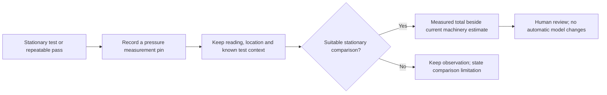

# 031 — Record and compare site measurements

Status: Implementation in progress; backend contract complete, editor/comparisons follow.
Related: 026 (optional band foundation), 027 (simple expanded editors), 003/005 (parked
measurement/validation themes). This brief adds one bounded POC feature, not those wider themes.

## Goal and baseline

The POC focuses on whether machinery could be audible from nearby town locations. The owner
can probably arrange stationary tests, repeated vehicle passes and specific activities, but
may not be able to measure town noise with machinery both operating and stopped. Meter
make/model and capabilities are currently unknown.

Add simple measurement pins linked to a machine and operating mode, recording pressure
readings for comparison with the model. The owner explicitly approved **record and compare
only**, leaving calibration for later. Existing receivers are hypothetical listening points;
measurements are observations and must look distinct. Existing calculations are geometric
estimates, not validated hearing-distance predictions.

## Scope

- Place, inspect, edit and remove a measurement pin using existing map/editor patterns.
  Required inputs are the measurement location and finite level. Record a machine/source
  link where known, operating activity, duration and measurement metric where known, and a
  short note for conditions such as weather, other equipment or a repeated-pass description.
  Meter details are optional plain text. Keep secondary fields in one compact disclosure;
  do not turn recording a point into an assessment form.
- Identify the quantity explicitly: **measured sound pressure**, not equipment LwA. Offer
  LAeq, a maximum-reading designation, and Unknown rather than silently interpreting a
  handheld reading as LAeq. Unknown metric/duration/meter data stays unknown, not a guessed
  default. Use plain wording so the owner can record what the meter actually provides.
- Distinguish stationary/steady tests from moving/pass-by tests and startup/other brief
  events. Capture them as observations; do not treat a startup maximum as sustained noise
  or a moving-pass average as a stationary-source prediction. Record repeated passes as
  separate points/readings; no trajectory reconstruction or statistics tool in this slice.
- Preserve readings, links, operating notes and unknowns through Save/Open and recovery.
  Old scenes default to no measurements. Moving a simulated source must not move its
  historical measurement pins. Deleting a linked machine must not delete the observations;
  retain the recorded label/context and make a missing link apparent.

## Comparison rules

Show a clearly labelled measured reading beside the **current scenario estimate at that
location**. Reuse current direct-point calculations and all active source contributions;
linking a measurement to a machine must not silently filter the modeled sources.

The measured reading generally includes background and other activity. The existing modeled
number describes machinery alone. Label those quantities separately. With no verified,
compatible background isolation, do not call their subtraction a prediction error, infer a
source power or report model accuracy. No background subtraction is included in this slice.

Only show a numerical model comparison as applicable for a known stationary/steady test
with an appropriate A-weighted energy-average reading and known duration/operating basis.
Even then, label the comparison as a geometric estimate, not validation. Moving tests,
startup/maxima, unknown metrics/basis, missing source context and pending/failed predictions
retain their observations and explain why a numerical comparison is unavailable. Do not
convert maxima to averages, assign an instantaneous source position to an entire pass, or
replace Unknown/Unavailable with zero. Existing negligible-overall-increase statuses remain
labelled as such, never interpreted as silence.

Comparisons describe **current** modeled inputs. Keep enough recorded machine/operation
context to make later source edits or removal apparent; do not present a newly calculated
value as a historical prediction made during the test. This is a small observation record,
not a versioned audit trail or automated calibration dataset.

## Exclusions

No fitting/calibration of machine powers, new attenuation or audibility algorithm, inferred
frequency bands, background subtraction, automatic interpolation/measurement heatmap, moving
source simulation, instrument integration, CSV import, report/printing feature, pass/fail
badge or new dependency/service. A measurement does not certify a source or validate a
mine-to-town propagation model. Spectral capture and meter-specific acquisition workflows
can be considered later, once actual capabilities and need are known.

## Acceptance

- [ ] A user can add/edit/delete a distinct measurement pin with a pressure level and location, optionally link its machine/activity and record known duration/metric/meter/conditions. Unknown fields remain blank/Unknown. Long notes and open cards remain usable at desktop and 390 px without tiny nested scroll areas or extra mandatory steps.
- [ ] Comparison respects the current/observed and machinery/total distinctions, uses all modeled sources and explicitly handles stationary eligibility, moving/max/unknown cases, changed/missing context, negligible/pending/failed results. Recording/editing a reading never changes source powers, background, contours, propagation or calibration; presentation-only actions make no acoustic requests.
- [ ] Save/Open/recovery retain complete and partial observations; old scenes remain compatible and source movement/deletion cannot move/delete observations. Numerical/data-boundary tests and full-app screenshots show matching values, unavailable states, preserved drafts and unchanged baseline results.

## Implementation and verification

Use then-current main and the existing Python/FastAPI, vanilla browser code and saved-scenario
contract. Announce task 031 before implementation. Keep this one feature in two reviewable
slices if needed: compatible saved-data contract first, then map/editor/comparison integration.
Do not use the parked assessment themes as permission to add more features.

Likely areas: saved types/validation in `src/scenario_files.py`; store/snapshot/recovery;
map placement/markers and entity editors; the existing direct prediction lane. Measurement
metadata changes should not recalculate sound; a new/corrected point may need its direct
estimate, while contour geometry stays untouched. Reuse supported coordinate/finite-value
validation and bounded requests without silently dropping observations.

Run appropriate pytest, Ruff, Pyright and browser checks. Use fictional stationary readings
and moving-pass records; test zero/negative/invalid levels, missing meter/metric/duration,
non-comparable readings, source edits/deletion, pending/stale results and persistence. Verify
no source-power/background/contour changes and no camera/disclosure-triggered sound requests.
Capture and inspect the actual open editor and comparison/unsupported states. No real field
measurements are supplied yet; do not invent them. Record commits, commands, evidence and
remaining limitations here when implemented.

## Backend slice — 19 November 2026

The owner selected task 031. [The measurement contract](../measurement-contract.md) defines
observations, historical model context and the independent direct-comparison endpoint. It
keeps source/pressure quantities separate, preserves deleted-source observations and defaults
old scenes to an empty collection. The backend does not use the observed pressure to fit or
change any model quantity. Current source operating labels are context, not a new noise model.

Backend checks: **182 pytest tests passed**; independent intensity and equal-source energy
references, inapplicable tests, changed/missing/mode context, negligible results, negative/zero
readings, invalid/duplicate data and saved/legacy records. Ruff and Pyright passed. No new
technology or real field readings were added. The compatible data/API slice is separate from
the map/editor integration; owner review and merge remain required.
