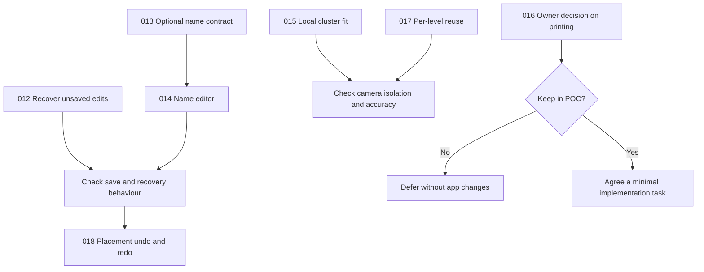
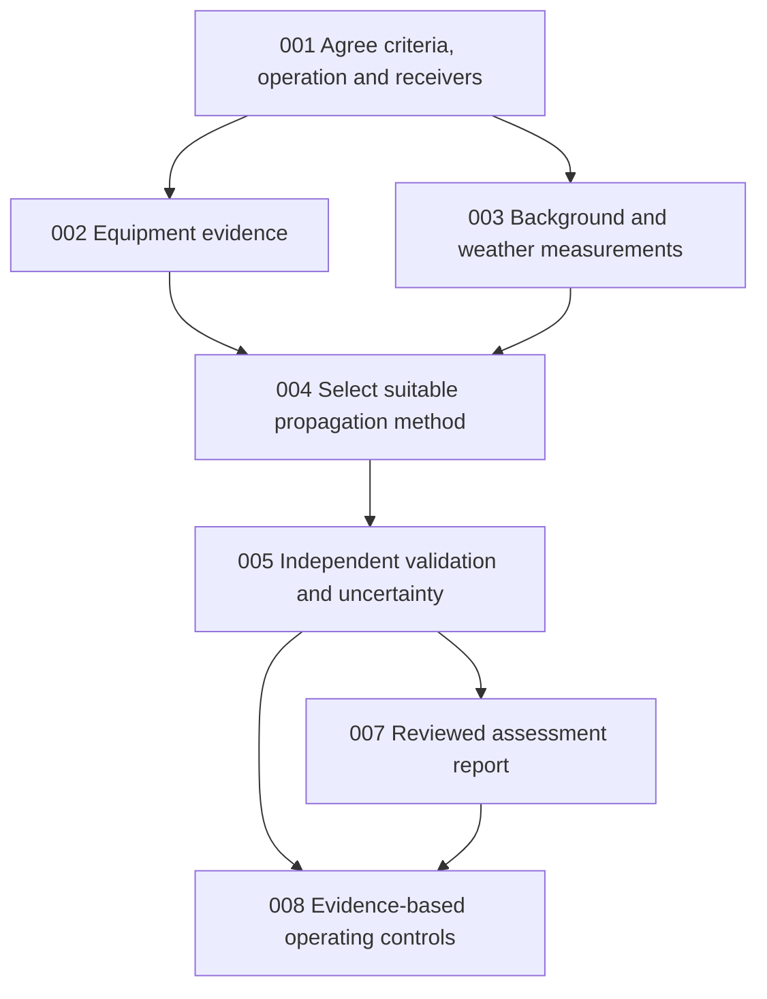

# Work backlog

[Documentation index](../README.md) · [Current model](../model.md) · [Project rules](../../AGENTS.md)

The goal is to assess and manage the risk of machinery disturbing nearby town receivers.
The app should support an honest assessment, not work towards a predetermined inaudibility result.

## POC work queue

The owner confirmed that this is a **proof of concept** on 17 November 2026. Keep the app
small. These task ideas were individually reviewed; this change writes the tasks, not their
implementations. Start with one ready task when instructed, verify it, then hand it back.
Do not treat approval to create tasks as a request to implement the whole queue now.

| Order | Agent task | State / dependency |
| --- | --- | --- |
| 1 | [012 Recover unsaved edits](012-unsaved-recovery.md) | Implemented; ready for review |
| 2 | [013 Optional receiver-name contract](013-receiver-name-contract.md) | Implemented; ready for review |
| 3 | [014 Receiver-name editor](014-receiver-name-editor.md) | Implemented; ready for review after 013 |
| 4 | [015 Fit a local cluster](015-local-cluster-zoom.md) | Implemented; ready for review |
| 5 | [017 Reuse unchanged contours](017-per-level-contour-cache.md) | Implemented; ready for review |
| 6 | [018 Placement undo/redo](018-placement-undo-redo.md) | Implemented; ready for review |
| 7 | [019 Optional equipment metadata](019-equipment-metadata-contract.md) | Implemented; ready for review |
| 8 | [020 Equipment metadata editor](020-equipment-metadata-editor.md) | Implemented; ready for review after 019 |
| 9 | [021 Optional acceptable-level data](021-acceptable-level-contract.md) | Implemented; ready for review |
| 10 | [025 Acceptable-level browser state](025-acceptable-level-browser-state.md) | Implemented; ready for review after 021 |
| 11 | [022 Special acceptable-level contour](022-acceptable-level-contour.md) | Implemented; ready for review after 025 |
| 12 | [023 Ctrl-click repeat placement](023-control-repeat-placement.md) | Implemented; ready for review |
| 13 | [027 Desktop sidebar usability](027-desktop-sidebar-usability.md) | Implemented; ready for review |
| 14 | [028 Address search with autocomplete](028-address-search-autocomplete.md) | Photon approved; API adapter ready, browser integration in progress |
| 15 | [029 Delete map objects in two clicks](029-map-object-deletion.md) | Ready; object popup then Delete |
| Investigation | [024 Source-aware scope policy](024-source-aware-model-scope.md) | Agree a defensible policy before code |
| Investigation | [026 Feasible propagation effects](026-feasible-propagation-effects.md) | Compare required data/methods; agree one small increment |
| Decision | [016 Keep or drop printable summary?](016-print-summary-decision.md) | Owner decision before any report implementation |

See the [implementation plan](../../tasks/plan.md) for order, checkpoints and branch bases.
Tasks have bounded scope, exclusions, acceptance criteria, likely files and concrete checks.
No new dependencies, services or regulatory criteria are approved by these briefs.

### Explicit scope decisions

- **JSON export/import:** declined as unnecessary for the POC; no new task.
- **Equipment evidence:** only optional source-reference and operating-mode text fields were
  approved (019–020). No attachments, uncertainty framework or evidence-management platform.
- **Printable summary:** tentative only; task 016 records the keep/remove decision. No full
  report, PDF generator or report implementation task is authorised yet.
- **Latest additions:** an optional user-set acceptable contour and Ctrl-click repeat
  placement are requested. Replacing distance-only scope needs a defensible policy (024),
  not a claim that the present model can establish audibility.
- **Accuracy:** contour reuse may avoid repeated work, but must not simplify geometry,
  omit sources or change the physical/numerical model.

This diagram shows the first usability batch and the print decision. The table above is the
complete queue, including equipment metadata, the special contour and scope investigation.

Checkpoints are verification points, not automatic merge approval. The owner reviews new
ideas before task creation; work stays on its branch until explicitly reviewed for merge.

## Parked wider themes

These pre-existing themes are retained as long-term context, **not POC deliverables**.
P0 means assessment credibility, P1 means reliability/operating decisions, and P2 means usability.
Priority is not readiness: collecting measurements needs site work, while a software slice may
be independently actionable once its idea and boundaries are approved.

| Theme | Priority | Current position | Input needed |
| --- | --- | --- | --- |
| [001 Assessment basis and town receivers](001-assessment-basis.md) | P0 | Not established | Owner/site team and qualified review of criteria |
| [002 Equipment evidence](002-equipment-evidence.md) | P0 | Free-text notes exist; verified dataset absent | Equipment documents and operating conditions |
| [003 Background and weather](003-background-and-weather.md) | P0 | No measurement dataset | Measurement plan, site access and quality review |
| [004 Propagation engine](004-propagation-engine.md) | P0 | Baseline only; candidates are unapproved | Method/data/licence review and owner approval |
| [005 Validation and uncertainty](005-validation-and-uncertainty.md) | P0 | Numerical tests exist; site validation absent | Independent measurements and suitable method |
| [006 Contour performance](006-contour-performance.md) | P1 | Compiled engine and per-level errors implemented | Approved cache slice: 017; other work parked |
| [007 Reproducible reports](007-scenarios-and-audit-trail.md) | P1 | Local saved inputs exist; report/audit features absent | Scope approval; criteria/validation for assessment claims |
| [008 Mitigation and controls](008-mitigation-and-operations.md) | P1 | Not implemented | Validated method, evidence and site responsibilities |
| [009 Map/editor usability](009-map-and-editor-usability.md) | P2 | Startup messages and numeric editing implemented | Approved local-fit slice: 015; approve any new provider |
| [010 Recovery and portable saves](010-scenario-autosave.md) | P1 | Explicit Save/Open and browser recovery implemented | Approved recovery slice: 012; export/import declined |
| [011 Simple workflow](011-simple-workflow.md) | P2 | Desktop tabs and compact markers implemented | Approved name/zoom/undo slices: 013–015, 018 |

## Assessment dependencies

This diagram describes the evidence process, not approved software tasks or an assertion that
any stage is complete. Equipment/background planning can start after the assessment basis is agreed.

## Standard for the next approved task

Keep it small enough for a focused session. Record the problem, existing baseline, exact scope,
explicit exclusions, dependencies, likely files, no more than three measurable acceptance criteria,
and concrete verification commands/browser steps. Name missing human inputs and approvals.
If it needs two independent features or much more than five implementation files, split it.

Use the actual existing stack and save schema. Finish with a handoff recording the commit,
checks, screenshots when relevant, remaining issues and the next dependency. Never mark a task
complete solely because tests passed if its stated behaviour or required evidence was not checked.
