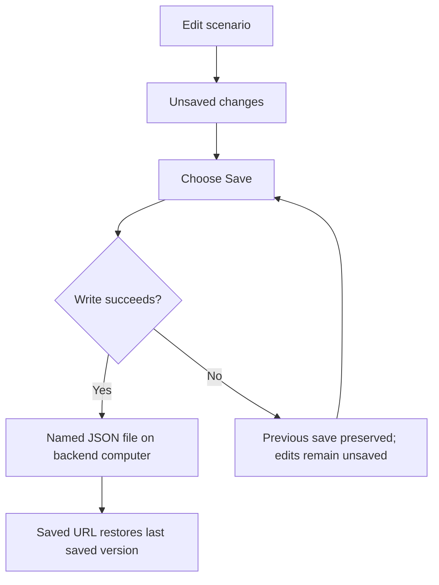

# Using Sound-Model

[Documentation index](README.md) · [Model explanation](model.md)

## Set up the map

Start the backend with the command in the [project README](../README.md#start-the-app).
Open the local address in an external browser if the VS Code preview cannot load the app.

**Greenbushes mine** fits a broad approximate area. It does not establish the site boundary.
Expand **Go to coordinates** for another location. Panning and zooming load imagery as
needed, but do not request new sound calculations.

## Add equipment and listening locations

A **machine type** holds a name, sound power and evidence note. A **machine on the map** is
one instance of that type. Several instances can share a type; editing its sound power
changes all those instances. Removing a type is prevented while it is in use.

1. Choose a type, select **Place machine**, and click its position.
2. Drag its icon to move it, or expand **Edit position** and enter coordinates.
3. Choose **Place a receiver**, then click the listening location.
4. Read its coloured pressure level on the map or in the sidebar. Expand **Details & position**
   for its coordinates and source contributions.

The machine icon's number matches its sidebar entry. Hover or keyboard-focus the icon for
its name and power; click/Enter for the evidence note. Moving a receiver updates readings,
while moving a machine updates both readings and contours.

The starter catalogue contains **guesses**, not confirmed company fleet data. In **Machine
data**, replace estimates with appropriate sound-power values and record their source.
A pressure measurement taken beside a machine is not automatically a sound-power value.

## Adjust contours

Use the **Contours** tab. Each row has a slider and editable number; duplicate levels are
rejected and rows sort from highest to lowest. Add/remove levels to change their count.
Contours cannot be dragged. Colours and line weight are automatic; **High contrast** adds
white halos. **Show lines** hides/shows them without changing the calculation.

| Result | What to do |
| --- | --- |
| Numeric receiver reading | Treat it as a screening machine contribution, excluding background |
| No sources | Place a machine; this does not mean the site has zero ambient noise |
| Outside scope | The nearest machine is beyond 10 km; no credible distant number is supplied |
| No crossing | That threshold has no line for the current field |
| Failed contour | Open its reason; other successful levels remain visible |
| Unavailable or startup error | Read the displayed error; use Retry when offered |

The app also flags receivers within 1 m of a source and totals containing distant source
paths. These warnings matter even when a number is shown. See [model limits](model.md).

## Save and reopen

First **Save** asks for a name. Later saves update the selected scenario. **Open** lists
saved scenarios; it also offers **New scenario** and, for an opened save, **Save current
work as a new copy**. Opening another scenario or starting a new one asks before discarding
unsaved changes.

Saves include equipment notes, machine/receiver positions, contour thresholds, cloud metadata,
map view, line visibility and contrast. They do not store satellite imagery or calculated
contour geometry. Results are recalculated when a scenario is reopened.

Reloading a saved URL loads its last saved version and offers **Restore/Discard** if a
browser recovery draft is available. Nothing is restored silently and named saves are never
automatically updated.
A fresh URL without a scenario ID starts a fresh scenario; use **Open** to find earlier saves.
The default storage folder is `local-data/scenarios/`, relative to the repository, on the
computer running the backend. Back up the folder while the app is not writing to it.

If files are unreadable, Open reports their count and preserves them. A saved URL cannot
restore a deleted or inaccessible file. Keep an independent copy of the storage folder;
there is no portable import/export UI yet.

## If the map is blank

- No controls or a startup error: check that the backend is running and open the address in
  Edge, Chrome or Firefox outside the VS Code preview.
- Controls work but imagery fails: check access to `server.arcgisonline.com`. Coordinates,
  placement and local calculations can still work against the plain background.
- **Loading** persists: read the eventual timeout/error notice; do not assume the acoustic
  model is waiting for imagery.

## Recover unsaved edits

Accepted changes are written to one versioned browser draft after a short debounce. Reload
or reopen the app and choose **Restore** to recover it, **Discard draft** to delete it, or
**Later** to keep it without replacing the current scene. **Review recovery draft** reopens
the prompt. Invalid drafts remain available to discard and are never applied partially.

Restored work is unsaved until you choose Save. If its original backend file was deleted,
it becomes a new unsaved scenario. In another scenario's URL the prompt identifies the draft
as different; Restore switches the working scene rather than mixing its machines into the URL's scene.

A second tab pauses draft writes when another tab owns the single draft, leaving explicit
Save available. If the draft changes during validation, review the latest version and retry.
This is a single recovery slot, not collaborative version history. Storage failures are shown
next to Save; previously stored draft data is retained when a write fails. Browser data can
be cleared and edits made immediately before a crash may precede the debounce. Keep named
saves and backups for important work.
