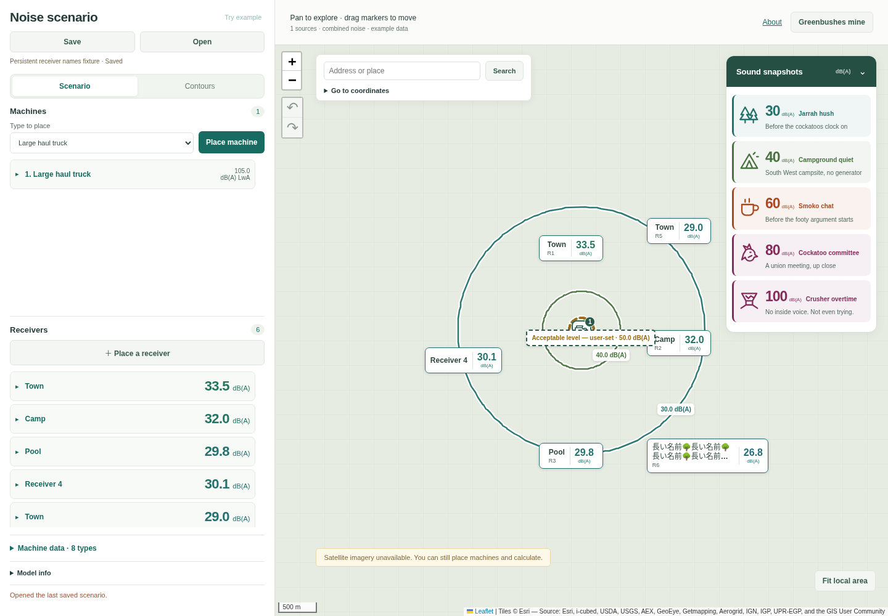
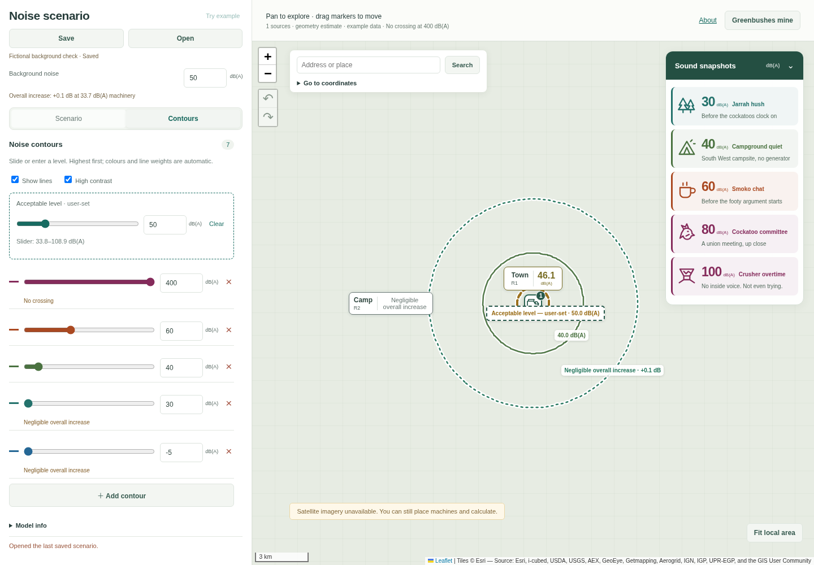
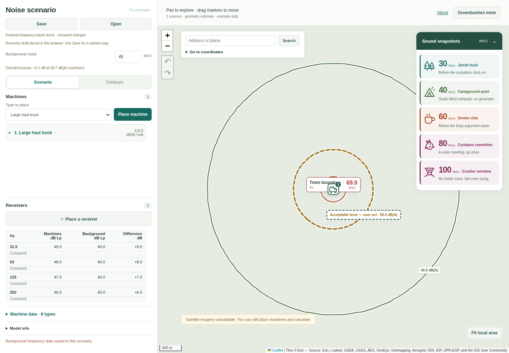
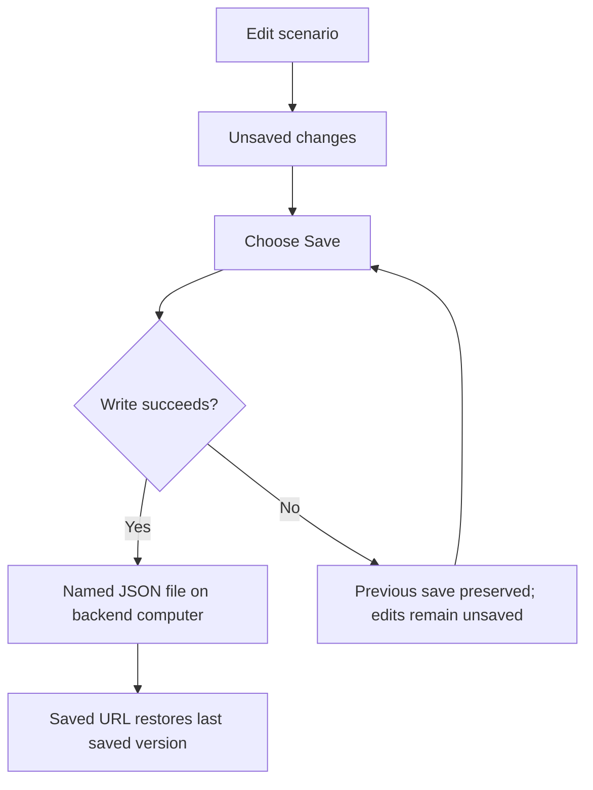

# Using Sound-Model

[Documentation index](README.md) · [Model explanation](model.md)

## Set up the map

Start the backend with the command in the [project README](../README.md#start-the-app).
Open the local address in an external browser if the VS Code preview cannot load the app.

**Greenbushes mine** opens the mine-wide starting view at −33.8675, 116.07647 (zoom 14),
matching the reference view. This camera is not a site boundary. Saved scenes reopen with
their saved camera instead.
**Fit local area**, at the map's lower right, frames the group nearest the current map centre.
Pan, search for an address/place or use coordinates to move near the area you want, then click Fit. Editing, clicking or
placing an object does not override the area you are currently viewing. The fitted group keeps
every pair of machines/receivers within 10 km, so a chain of neighbours cannot pull in a
separate test area. Objects outside the view still contribute to the sound calculation.

The action is disabled in an empty scene and caps zoom at 16 for a single location.
It leaves room for open map controls, and never runs automatically after an edit.

Type in **Address or place** and choose a suggestion, or use Arrow Down/Up and Enter.
Typing alone never moves the map. Escape closes suggestions. The **×** inside the field
clears the address and suggestions, leaving the map where it is. Add a town or postcode when
results are ambiguous. **Search** can retry a failed lookup; **Go to coordinates** works
without address lookup. Panning and zooming load imagery as
needed, but do not request new sound calculations.

## Add equipment and listening locations

A **machine type** holds a name, sound power and evidence note. A **machine on the map** is
one instance of that type. Several instances can share a type; editing its sound power
changes all those instances. Removing a type is prevented while it is in use.

1. Choose a type, select **Place machine**, and click its position. To place several,
   **Ctrl-click** each position, then click without Control to place the last machine.
   **Escape** or **Cancel placement** exits without adding another. Placement stops at 100 machines.
2. Drag its icon to move it, or expand its machine row and enter coordinates.
3. Choose **Place a receiver**, then click the listening location.
4. Read its coloured pressure level on the map or in the sidebar. Expand its receiver row
   to add an optional name or edit coordinates. **Machine contributions** shows individual sources.

On desktop, Save/Open and the workspace tabs stay above the two compact object lists.
Machine rows show their sound power; receiver rows show their current reading. Expand only
the row you need. Machine data and Model info open one at a time, retaining their drafts.

Opening an editor gives it the full sidebar height and one scroll area. Cards that fit in
the window are brought fully into view; longer forms scroll naturally. **Close editor**
returns to the compact lists and their previous scroll positions. Closing preserves field
drafts; use the form's Save/Move action to apply unsubmitted changes.

Names stay visible beside coloured readings on the map and in the sidebar. Named map
badges include an R-number to distinguish repeated names. Clear the name to restore
**Receiver N**. Names can contain up to 80 characters, may repeat, and are kept by
Save/Open and recovery. Long map names use at most two lines; hover or keyboard-focus
the badge to read the full name. Names remain visible while a reading is pending or unavailable.

To remove an object on the map, click its marker, then **Delete machine** or **Delete
receiver**. Holding **Ctrl** shows a small red **×** on each visible object for one-click
removal. Release Ctrl or press Escape to hide the × controls. **Undo** restores a deletion.
Selecting an object exits placement; Ctrl-click on empty map space still repeats placement.

The machine icon's number matches its sidebar entry. Hover or keyboard-focus the icon for
its name and power; click/Enter for the evidence note. Moving a receiver updates readings,
while moving a machine updates both readings and contours.

The starter catalogue contains **guesses**, not confirmed company fleet data. In **Machine
data**, replace estimates with appropriate sound-power values and record their source.
Expand **Estimate notes & edit** to record an optional **Source reference** and
**Operating mode**, then choose **Save type**. These text fields accompany the existing note
and are kept by Save/Open and recovery; they do not change the calculated sound or mark
an estimate as measured. References are plain text, not downloads.
A pressure measurement taken beside a machine is not automatically a sound-power value.

## Undo a placement edit

Use **Undo / Redo** beneath the map zoom controls for machine and receiver placement, moves and removals.
Each completed drag or submitted coordinate change counts as one action; up to 50 are retained.
A new placement edit clears redo. Outside form fields, use Ctrl/Cmd+Z to undo, Ctrl/Cmd+Shift+Z
or Ctrl+Y to redo. Text fields keep their native undo behaviour.

Undo/redo marks the working scene unsaved and updates the browser recovery draft. A named
save changes only when you choose Save. Opening, starting or restoring a scene clears history;
recovery restores inputs rather than the undo stack. Deleting an unused machine type also
clears history so it cannot restore a machine whose type has been deleted. Current equipment
power and receiver names are retained when undoing coordinate moves.

## Adjust contours

Use the **Contours** tab. Each row has a slider and editable number; duplicate levels are
rejected and rows sort from highest to lowest. Choose **Add contour**, type a number and
press **Enter**. The new draft uses the same slider-and-number row; **Escape** or its **×**
dismisses it without adding a level. Sliders use the current-machine range; numeric entry
retains 0–300 dB(A). Remove levels with their × buttons.
Changing one level reuses unchanged contours; they remain visible while the new level loads.
If it fails, Retry recalculates missing/failed contours while keeping successful ones.
Contours cannot be dragged. Colours and line weight are automatic; **High contrast** adds
white halos. **Show lines** hides/shows them without changing the calculation.

| Result | What to do |
| --- | --- |
| Numeric receiver reading | Treat it as a screening machine contribution, excluding background |
| No sources | Place a machine; this does not mean the site has zero ambient noise |
| Negligible overall increase | Machinery adds less than 0.1 dB to the entered background |
| No crossing | That threshold has no line for the current field |
| Failed contour | Open its reason; other successful levels remain visible |
| Unavailable or startup error | Read the displayed error; use Retry when offered |

The app flags receivers within 1 m of a source. These are numerical limits rather than
near-field predictions. See [model limits](model.md).

### Set background noise

Enter **Background noise** above the workspace tabs. Use one measured or explicitly assumed
level for the whole scenario; zero is a valid level, while blank means not set. The app does
not supply a guessed default. Save/Open and recovery retain your value.

A dotted outer contour marks where all machines together add **0.1 dB** to background.
Receivers beyond it show **Negligible overall increase**. Lower contour levels remain in your list
with that status, and reappear if the background or machines change. The automatic boundary
is derived, so it does not need another editable contour row. A failed boundary is identified
in contour error details; successful other levels remain visible.

Numeric readings still show the machinery contribution, excluding background. Negligible
increase does not guarantee that machinery cannot be heard. Clear background to turn this
filter off. There is no fixed receiver-distance cutoff or numeric contour-level cap;
calculation budgets and supported map projection can still cause individual line failures.

### Set an acceptable-level reference

In **Contours**, drag the **Acceptable level** slider or enter a number. The slider becomes
available after its current-machine range is checked. Its heavier dashed line is labelled **Acceptable level — user-set**. It starts unset;
**Clear** removes the reference while keeping ordinary contours. This is your reference,
not an approved compliance limit or a determination that machinery cannot be heard.

Matching an ordinary threshold shares one calculation and line. The count allows 25 unique
editable thresholds including the reference, plus the derived outer boundary; if full, remove a level or choose an existing one. A failed
reference names its level and reason while successful ordinary contours remain visible.
The slider uses a practical contour-producing interval for the current machines. Bounds are
checked with the current model, background and geometry engine; they are not a claim of the full feasible range or
environmental validation. Numeric entry accepts any finite dB(A) value, and a source change does
not silently change your chosen value. Per-level extraction failures can still be reported.
Save/Open and recovery retain the setting. Show lines and High contrast apply to it too.

## Optional frequency-band evidence

Use this only when you have suitable band data. If all you have is an overall dB(A) value,
leave the band fields blank; do not copy that value into every band or invent a spectrum.

1. In **Machine data → Estimate notes & edit → Frequency data (optional)**, enter unweighted
   octave-band **sound power** for that machine type. The profile applies to all instances
   of that type. Record the energy-average duration, assumed/measured classification and
   a source/operating reference, then **Save type**.
2. In **Model info → Background frequency data (optional)**, enter unweighted band
   **pressure** levels with their duration and evidence reference, then **Save background
   bands**. This one background spectrum applies throughout the scenario.
3. Expand a receiver and open **Frequency comparison**. The table shows unweighted receiver
   band pressures, background pressures and signed machinery-minus-background differences.

Blank bands are unknown, while zero and negative dB values are valid levels. Missing source
bands or durations prevent a complete total for that band. Background comparisons require
matching durations; also check that measurements represent suitable operating conditions.
Unknown/mismatched data stays labelled rather than becoming a partial sum or a false zero.

Band data does **not** replace the existing overall LwA/background values, change contours,
or calculate an audibility boundary. Unweighted bands are not silently converted to dB(A).
A positive difference does not prove audible and a negative difference does not prove inaudible.
Save/Open and recovery retain the evidence, including partial profiles; old scenes have none.
Expanded editors/results use the sidebar viewport rather than small nested scroll panels.

## Save and reopen

First **Save** asks for a name. Later saves update the selected scenario. **Open** lists
saved scenarios; it also offers **New scenario** and, for an opened save, **Save current
work as a new copy**. Opening another scenario or starting a new one asks before discarding
unsaved changes.

Saves include equipment notes, machine/receiver positions, contour thresholds, cloud metadata,
map view, line visibility and contrast. They do not store satellite imagery or calculated
contour geometry. Results are recalculated when a scenario is reopened.

Reloading a saved URL loads its last saved version and offers **Restore/Discard** if a
browser recovery draft is available. Nothing is restored silently and named saves are never
automatically updated.
A fresh URL without a scenario ID starts a fresh scenario; use **Open** to find earlier saves.
The default storage folder is `local-data/scenarios/`, relative to the repository, on the
computer running the backend. Back up the folder while the app is not writing to it.

If files are unreadable, Open reports their count and preserves them. A saved URL cannot
restore a deleted or inaccessible file. Keep an independent copy of the storage folder;
there is no portable import/export UI yet.

## If the map is blank

- No controls or a startup error: check that the backend is running and open the address in
  Edge, Chrome or Firefox outside the VS Code preview.
- Controls work but imagery fails: check access to `server.arcgisonline.com`. Coordinates,
  placement and local calculations can still work against the plain background.
- **Loading** persists: read the eventual timeout/error notice; do not assume the acoustic
  model is waiting for imagery.

## Recover unsaved edits

Accepted changes are written to one versioned browser draft after a short debounce. Reload
or reopen the app and choose **Restore** to recover it, **Discard draft** to delete it, or
**Later** to keep it without replacing the current scene. **Review recovery draft** reopens
the prompt. Invalid drafts remain available to discard and are never applied partially.

Restored work is unsaved until you choose Save. If its original backend file was deleted,
it becomes a new unsaved scenario. In another scenario's URL the prompt identifies the draft
as different; Restore switches the working scene rather than mixing its machines into the URL's scene.

A second tab pauses draft writes when another tab owns the single draft, leaving explicit
Save available. If the draft changes during validation, review the latest version and retry.
This is a single recovery slot, not collaborative version history. Storage failures are shown
next to Save; previously stored draft data is retained when a write fails. Browser data can
be cleared, and edits made immediately before a crash may not have passed the debounce or
the browser's own disk flush. Keep named
saves and backups for important work.
