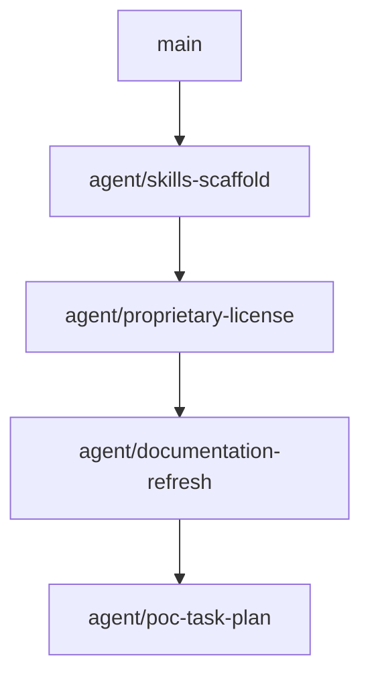

# POC implementation plan

[Canonical task queue](../docs/tasks/README.md) · [Project rules](../AGENTS.md)

Updated 17 November 2026 after the owner's task-by-task review. The scope is a small proof
of concept, balancing usability and assessment foundations without building a full assessment
platform. This plan prepares work for agents; no queued feature is implemented by this change.
Task states and acceptance checkboxes live only in the linked task briefs, not a second todo list.

## Decisions

- Keep the approved Python/FastAPI and plain HTML/CSS/JavaScript stack. No new technology is
  approved. Existing numeric inputs and free-text notes stay in place; two optional equipment metadata
  fields are approved, without an evidence-management system.
- Recover unsaved edits while retaining explicit named Save/Open semantics.
- Receiver names are optional. Split the compatible data contract from the small editor change.
- Fit only a local group, without changing acoustic source selection. Every pair in the fitted
  group must be within 10 km; use a deterministic anchored group, never chained connectivity.
- Reuse contours without changing equations, source contributions, geometry or accuracy.
- Add bounded placement undo/redo; do not build persistent or collaborative history.
- The owner declined portable JSON export/import. Only source-reference and operating-mode metadata is approved for equipment.
- A printable summary requires an explicit keep/remove decision before an implementation task.

## Work order and checkpoints

| Stage | Task | Dependency / checkpoint |
| --- | --- | --- |
| Recover work | [012](../docs/tasks/012-unsaved-recovery.md) | Implemented on `agent/recover-unsaved-edits`; ready for review |
| Name receivers | [013](../docs/tasks/013-receiver-name-contract.md), then [014](../docs/tasks/014-receiver-name-editor.md) | 013 and 014 implemented for review; merge the contract before its editor |
| Checkpoint A | Recovery and naming | Save/Open/reload, invalid drafts, preserved IDs/notes and open-state screenshots |
| Navigate locally | [015](../docs/tasks/015-local-cluster-zoom.md) | Implemented for review; maximum pairwise distance 10 km; no acoustic filtering |
| Avoid repeated work | [017](../docs/tasks/017-per-level-contour-cache.md) | Implemented for review; preserve coordinates, accuracy and stale-response rejection |
| Checkpoint B | Zoom and cache | No acoustic calls on navigation; unaffected contours reused; existing geometry tests pass |
| Recover mistakes | [018](../docs/tasks/018-placement-undo-redo.md) | Implemented for review; integrate with recovery and scenario lifecycle |
| Checkpoint C | Complete selected POC slice | Acceptance evidence, appropriate full checks, small UI and clear handoff |
| Optional equipment metadata | [019](../docs/tasks/019-equipment-metadata-contract.md), then [020](../docs/tasks/020-equipment-metadata-editor.md) | Both implemented for review; merge saved-data contract before collapsed editor |
| Requested map controls | [021](../docs/tasks/021-acceptable-level-contract.md), [025](../docs/tasks/025-acceptable-level-browser-state.md), then [022](../docs/tasks/022-acceptable-level-contour.md); [023](../docs/tasks/023-control-repeat-placement.md) | Acceptable-level contract/state/line implemented for review; Ctrl repeat placement implemented for review |
| Sidebar usability | [027](../docs/tasks/027-desktop-sidebar-usability.md) | Implemented for review; verified fewer scroll gestures with unchanged workflow click count |
| Address navigation | [028](../docs/tasks/028-address-search-autocomplete.md) | Photon approved; API adapter implemented, browser integration follows; camera changes only |
| Map object removal | [029](../docs/tasks/029-map-object-deletion.md) | Two clicks: select object, then Delete; reuse history and recovery |
| Scope investigation | [024](../docs/tasks/024-source-aware-model-scope.md) | Reconsider distance-only withholding for receivers and lines; agree policy first |
| Model feasibility | [026](../docs/tasks/026-feasible-propagation-effects.md) | Identify credible small additions; do not implement missing physics by guesswork |
| Optional decision | [016](../docs/tasks/016-print-summary-decision.md) | Owner may remove printing as scope creep; no report code before decision |

An agent should take one task at a time, recording the commit, checks and remaining limits.
If a task grows into multiple independent features, split it and get approval for any new idea.
A good starting instruction is: “Work on task 012 within its scope, verify it, and prepare the
change for review. Do not merge or start another task automatically.”

## Current contour-fix review stack

These fixes stack above the acceptable-level feature in #25 (and its #23/#24 prerequisites).
The complete product branch is `agent/add-contour-number`.

| PR | Scope | Base |
| --- | --- | --- |
| [#27](https://github.com/Jakespitteler/Sound-Model/pull/27) | Foreground acceptable label | `agent/acceptable-level-contour` |
| [#28](https://github.com/Jakespitteler/Sound-Model/pull/28) | Working scenario-aware slider | `agent/acceptable-label-priority` |
| [#29](https://github.com/Jakespitteler/Sound-Model/pull/29) | Click, type and Enter to add a contour | `agent/scenario-contour-slider` |

Merge in order and retarget each next PR to `main` when its dependency lands. No automatic
merge is authorised. The range probes use the existing model and scope, not new attenuation.

## Earlier acceptable-level feature stack

| PR | Scope | Base |
| --- | --- | --- |
| [#23](https://github.com/Jakespitteler/Sound-Model/pull/23) | Task 021: optional saved reference | `main` |
| [#24](https://github.com/Jakespitteler/Sound-Model/pull/24) | Task 025: browser state and budget | `agent/acceptable-level-contract` |
| [#25](https://github.com/Jakespitteler/Sound-Model/pull/25) | Task 022: user-set reference contour | `agent/acceptable-level-state` |

The complete product is `agent/acceptable-level-contour`. Merge in table order, retargeting
the next PR to `main` once its dependency merges. No automatic merge is authorised.

## Earlier placement/equipment review stack

Merge and review from the bottom of the dependency chain upward. Each PR targets the branch
immediately below it; the complete product is `agent/equipment-metadata-editor`.

| PR | Scope | Base |
| --- | --- | --- |
| [#18](https://github.com/Jakespitteler/Sound-Model/pull/18) | Task 018: placement undo/redo | `main` |
| [#19](https://github.com/Jakespitteler/Sound-Model/pull/19) | Persistent map Undo/Redo controls | `agent/placement-undo-redo` |
| [#20](https://github.com/Jakespitteler/Sound-Model/pull/20) | Task 019: equipment metadata contract | `agent/persistent-history-controls` |
| [#21](https://github.com/Jakespitteler/Sound-Model/pull/21) | Task 020: collapsed metadata editor | `agent/equipment-metadata-contract` |

Retarget the next PR to `main` after its dependency merges. No automatic merge is authorised.

## Earlier setup PR stack

| Review unit | Head branch | Base branch | Contents |
| --- | --- | --- | --- |
| Agent scaffold | `agent/skills-scaffold` | `main` | Exact skill snapshot, project agent guidance and integrity checker |
| Ownership terms | `agent/proprietary-license` | `agent/skills-scaffold` | Owner-only project licence/metadata and third-party notices |
| Current documentation | `agent/documentation-refresh` | `agent/proprietary-license` | Current guides, corrected historical labels and diagrams |
| POC task queue | `agent/poc-task-plan` | `agent/documentation-refresh` | Owner-approved task briefs and plan; no feature implementation |

The earlier `agent/add-agent-skills` branch is retained, not force-rewritten. The new heads
separate its two existing commits for review. Merge the scaffold first, then the licence, then documentation, then the task queue; retarget the next PR to main
once its dependency lands. Actual PR URLs are recorded after creation; pushed branches and
compare links are not evidence that a PR exists. No automatic merge is authorised.

Future implementation slices should each be a separate small PR based on the then-current
reviewed dependency. Do not mix feature implementation into the scaffold PR.

The 10 km maximum pairwise cluster distance is a camera rule. It must not be confused with
the current 10 km acoustic display policy, which task 024 now reconsiders at the owner's request. An extreme 300 dB source is not evidence that the machinery model simulates an explosion.

## Open decisions

- Task 024: agree the smallest defensible source/model-aware display policy without inventing audibility.
- Task 016: keep or remove the printable summary from the POC?

Measurements, environmental propagation selection, regulatory criteria and formal reporting
remain parked. The app's limitations stay visible; a POC is not an inaudibility certificate.
